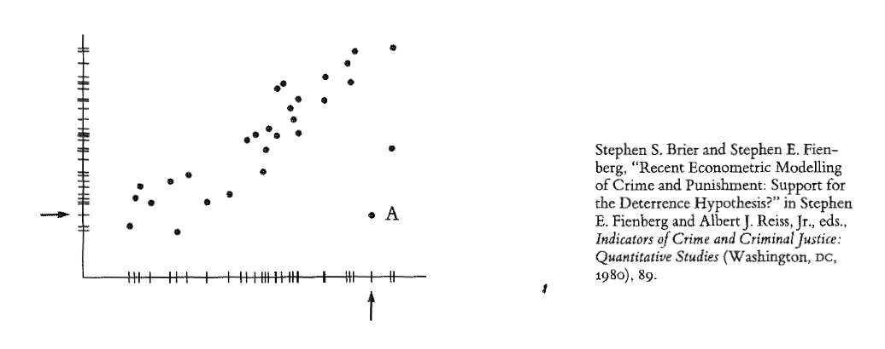
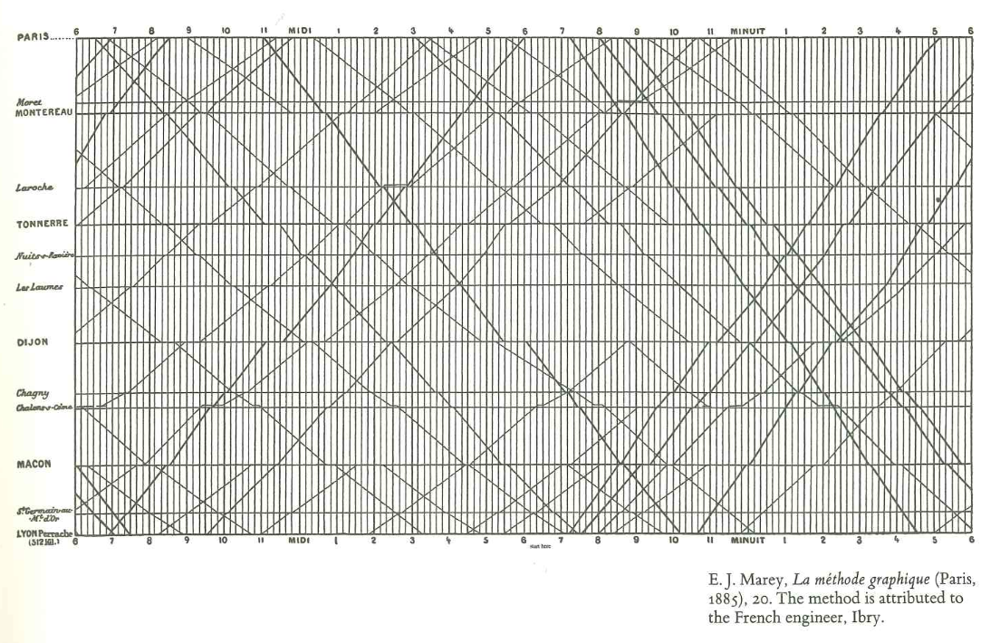
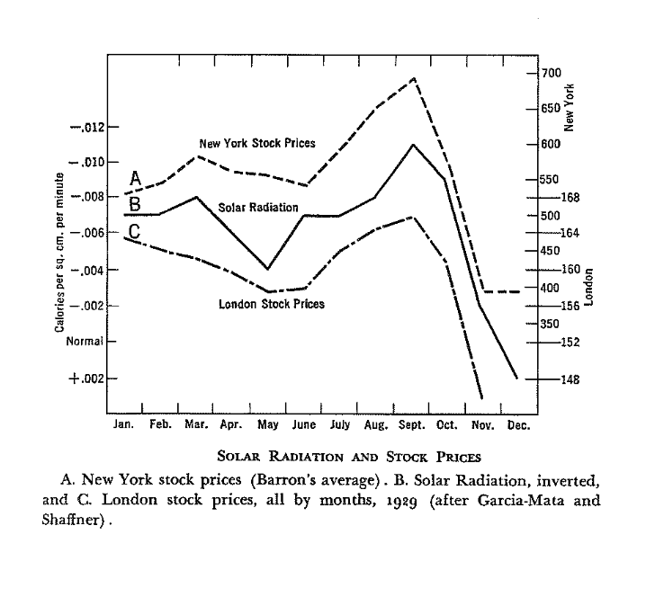
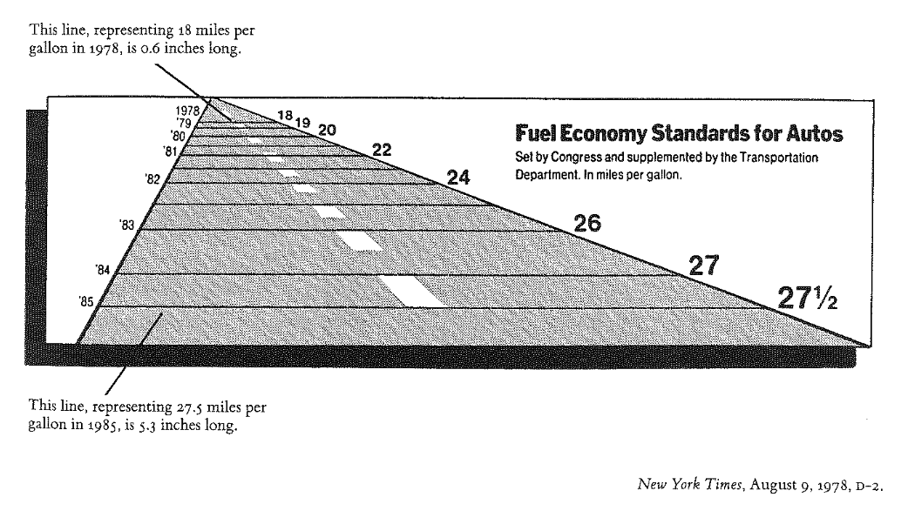
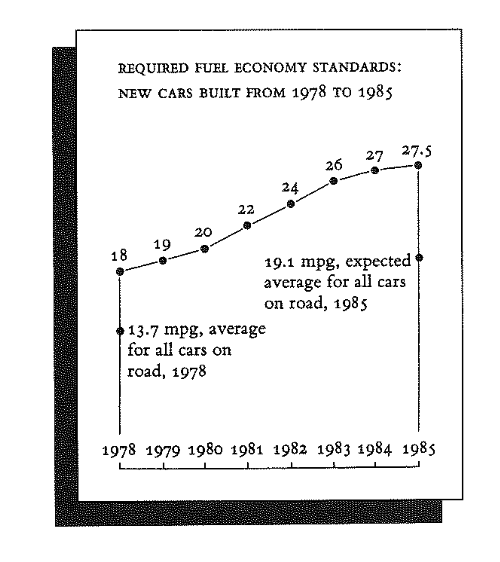
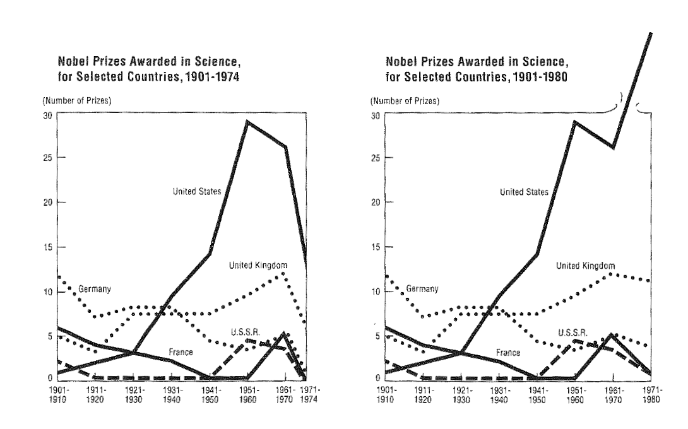
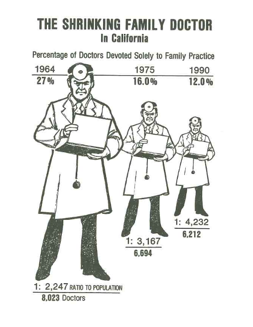

# Prelude

## Announcements


## Today's topics

- Critiquing figures
- Work session
  - Exercise 04
  - Final Project proposal

# Critiquing figures

## Edward Tufte

:::: {.columns}
::: {.column width=50%}
![Edward Tufte: Wikipedia^[By Keegan Peterzell - Own work, CC BY-SA 4.0, https://commons.wikimedia.org/w/index.php?curid=40367115]](https://thumb.wikimedia.org/wikipedia/commons/thumb/4/46/Edward_Tufte_-_cropped.jpg/1280px-Edward_Tufte_-_cropped.jpg?utm_source=en.wikipedia.org&utm_campaign=imageinfo&utm_content=thumbnail){width="50%"}
:::
::: {.column width=50%}
- Professor Emeritus, Yale University
- Statistics, Political Science, Computer Science
- Leading authority in data visualization and information design
:::
::::

---

{#fig-online-course width="55%"}

## Figures can enlighten

{#fig-tufte-scatter-p14}

---

{#fig-john-snow-cholera width="65%"}

## Figures can delight

{#fig-tufte-french-rail-p31 width="65%"}

## Figures can mislead

{#fig-tufte-illusory-corr-p15 width="55%"}

## Spurious correlations

{#fig-tylervigen-spurious}

## Spurious correlation

:::: {.columns}
::: {.column width=50%}

:::
::: {.column width=50%}
- Correlation $\neq$ causation, but...
- Zero correlation $\rightarrow$ no causal relationship
:::
::::

---

:::: {.columns}
::: {.column width=50%}

:::
::: {.column width=50%}

:::
::::

---

{#fig-tufte-p60}

---

{#fig-tufte-p75 width="45%"}

## Your turn

- What sort of data picture (figure) would be less misleading?

## An alternative

```{r}
#| echo: true
p_family_practice <- c(.27, .16, .12)
year <- c(1964, 1975, 1990)
ratio_to_pop <- c(2247, 3167, 4232)
n_docs <- c(8023, 6694, 6212)

docs_df <- data.frame(year, p_family_practice, ratio_to_pop, n_docs)
```

---

```{r}
library(ggplot2)
library(dplyr)
docs_df |>
  mutate(year = factor(year)) |>
  ggplot() +
  aes(x = year, p_family_practice) +
  geom_bar(stat = "identity")
```

---

```{r}
docs_df |>
  mutate(year = factor(year)) |>
  ggplot() +
  aes(x = year, n_docs) +
  geom_bar(stat = "identity")
```

## Even better?

```{r}
#| echo: true

n_family <- n_docs*p_family_practice
n_non_family <- n_docs*(1 - p_family_practice)
n_docs_specialty <- c(n_family, n_non_family)
years <- rep(year, 2)
specialty <- rep(c("Family Practice", "Non-Family Practice"), each = length(year))

docs_df_new <- data.frame(years, specialty, n_docs = n_docs_specialty)
```

---

```{r}
#| label: fig-docs-by-specialty
#| fig-cap: "Doctors in California by speciality 1964-1990."
#| echo: true
docs_df_new |>
  mutate(years = factor(years)) |>
  ggplot() +
  aes(x = years, y = n_docs, fill = specialty) +
  geom_bar(stat = "identity") +
  ylab("Doctors") +
  xlab("") +
  theme_classic() +
  theme(legend.title = element_blank())
```

## Another alternative

```{r}
total_pop <- n_docs*ratio_to_pop
pop <- c(total_pop, n_docs)
docs_general <- rep(c("Non-doctors", "Doctors"), each = 3)

docs_df_another <- data.frame(years, docs_general, pop)
```

---

```{r}
#| label: fig-docs-as-p-population
#| fig-cap: "Doctors vs. non-doctors in California as a fraction of the total population 1964-1990."
#| echo: true
docs_df_another |>
  mutate(years = factor(years)) |>
  ggplot() +
  aes(x = years, y = pop, fill = docs_general) +
  geom_bar(stat = "identity", position = position_dodge2(preserve = "single")) +
  ylab("Population") +
  xlab("") +
  theme_classic() +
  theme(legend.title = element_blank())
```
```

# Resources

## References
