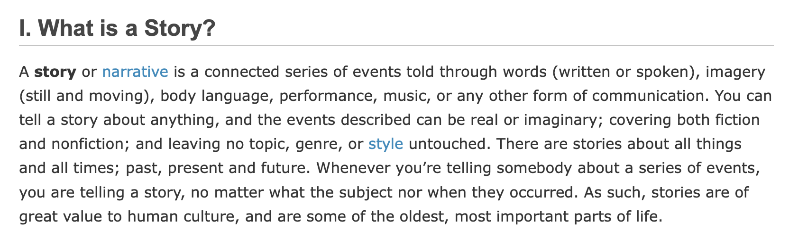
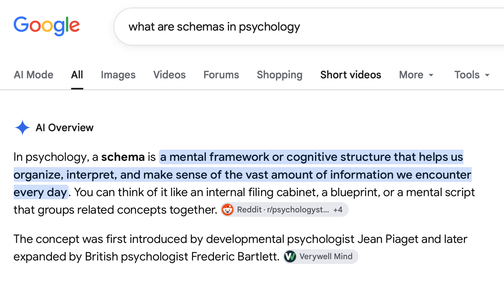
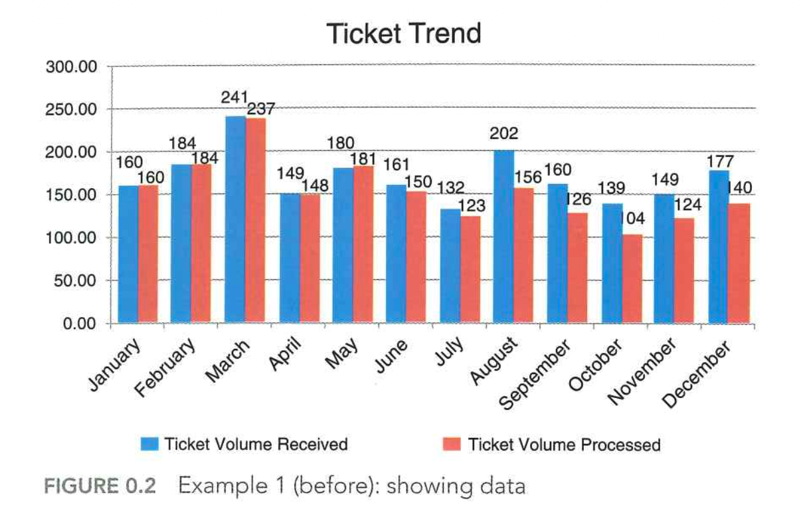
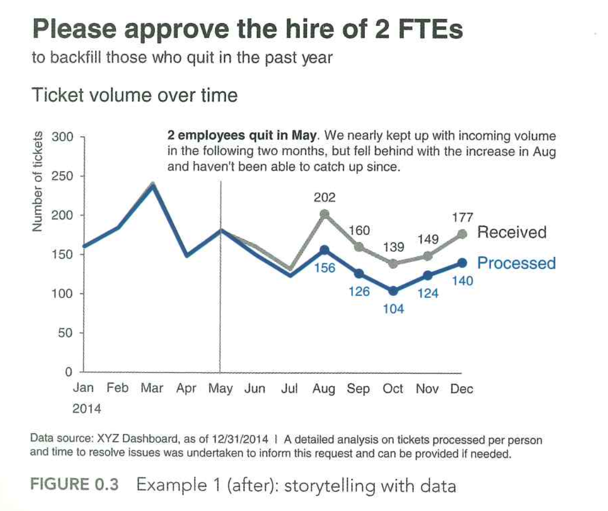
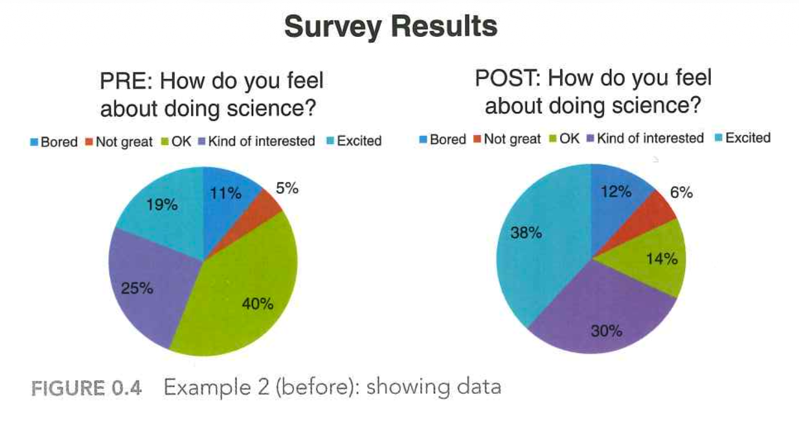
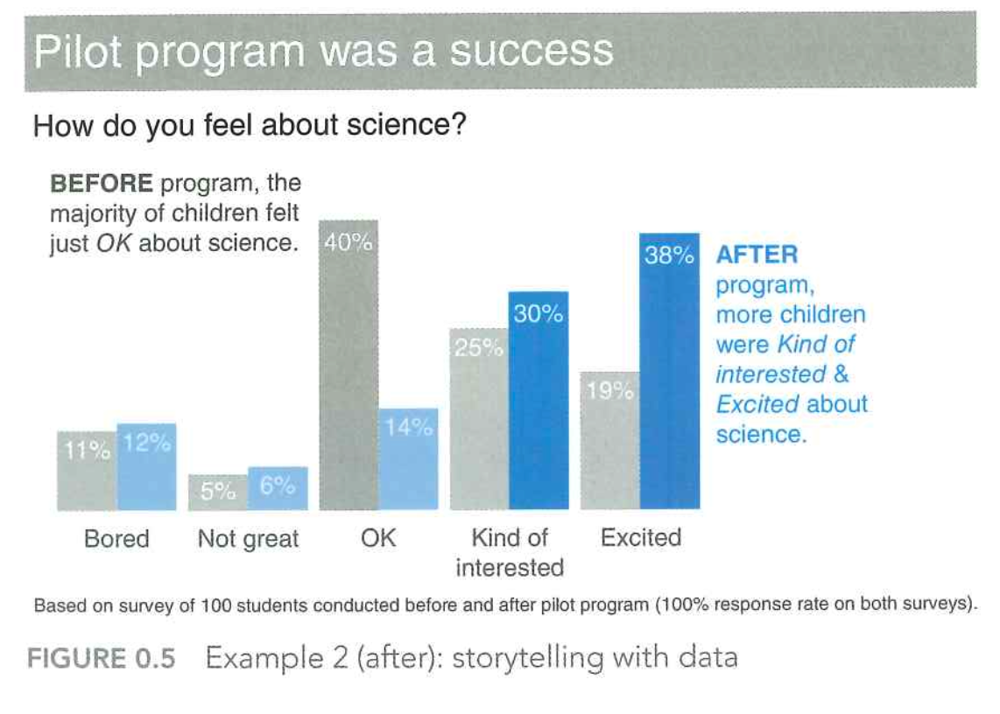
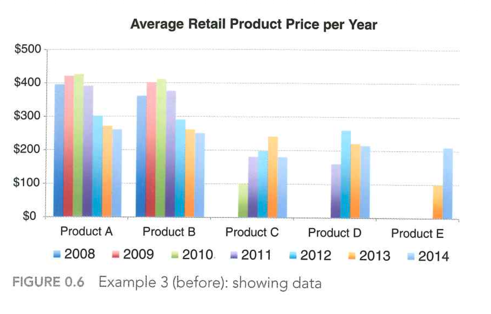
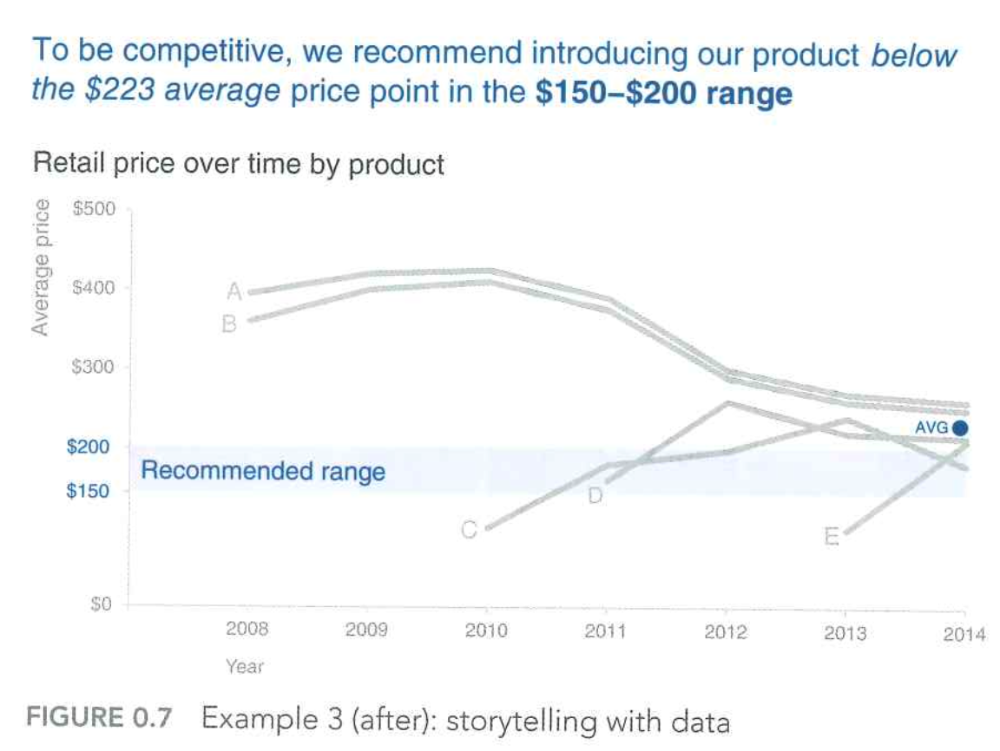
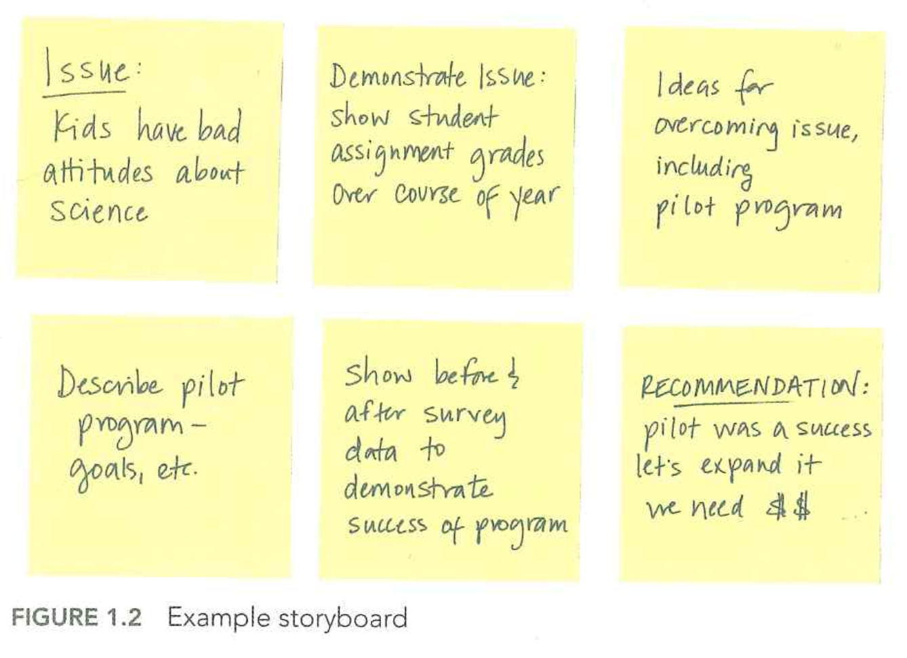

# Prelude

## Announcements

- [Exercise 04](../exercises/ex-04-making-figs-ggplot.qmd) due Friday
- [Final Project proposal](../exercises/final-project.qmd) due Friday

## Last time...

:::: {.columns}

::: {.column width=50%}
- Tufte on critiquing figures
:::

::: {.column width=50%}
{#fig-tufte-p75 width="45%"}
:::

::::

## An alternative

```{r}
#| echo: true
p_family_practice <- c(.27, .16, .12)
year <- c(1964, 1975, 1990)
ratio_to_pop <- c(2247, 3167, 4232)
n_docs <- c(8023, 6694, 6212)

docs_df <- data.frame(year, p_family_practice, ratio_to_pop, n_docs)
```

---

```{r}
library(ggplot2)
library(dplyr)
docs_df |>
  mutate(year = factor(year)) |>
  ggplot() +
  aes(x = year, p_family_practice) +
  geom_bar(stat = "identity")
```

---

```{r}
docs_df |>
  mutate(year = factor(year)) |>
  ggplot() +
  aes(x = year, n_docs) +
  geom_bar(stat = "identity")
```

## Even better?

```{r}
#| echo: true

n_family <- n_docs*p_family_practice
n_non_family <- n_docs*(1 - p_family_practice)
n_docs_specialty <- c(n_family, n_non_family)
years <- rep(year, 2)
specialty <- rep(c("Family Practice", "Non-Family Practice"), each = length(year))

docs_df_new <- data.frame(years, specialty, n_docs = n_docs_specialty)
```

---

```{r}
#| label: fig-docs-by-specialty
#| fig-cap: "Doctors in California by speciality 1964-1990."
#| echo: true
docs_df_new |>
  mutate(years = factor(years)) |>
  ggplot() +
  aes(x = years, y = n_docs, fill = specialty) +
  geom_bar(stat = "identity") +
  ylab("Doctors") +
  xlab("") +
  theme_classic() +
  theme(legend.title = element_blank())
```

## Another alternative

```{r}
total_pop <- n_docs*ratio_to_pop
pop <- c(total_pop, n_docs)
docs_general <- rep(c("Non-doctors", "Doctors"), each = 3)

docs_df_another <- data.frame(years, docs_general, pop)
```

---

```{r}
#| label: fig-docs-as-p-population
#| fig-cap: "California population 1964-1990."
#| echo: true
docs_df_another |>
  mutate(pop_millions = pop/1e6) |>
  filter(docs_general == "Non-doctors") |>
  ggplot() +
  aes(x = years, y = pop_millions) +
  geom_point() +
  geom_line() +
  ylab("Population (M)") +
  xlab("") +
  ylim(0, 30) +
  theme_classic() +
  ggtitle("California's population has increased since 1964 by 8 million")
```

---

```{r}
#| label: fig-population
#| fig-cap: "California doctors 1964-1990."
#| echo: true
docs_df_another |>
  # mutate(years = factor(years)) |>
  filter(docs_general == "Doctors") |>
  ggplot() +
  aes(x = years, y = pop) +
  geom_point() +
  geom_line() +
  ylab("Doctors") +
  xlab("") +
  ylim(0, 10000) +
  theme_classic() +
  theme(legend.title = element_blank()) +
  ggtitle("But the number of doctors has declined by 1,800.")
```

## Today's topics

- Storytelling with data

# Storytelling with data

## What is a story?

::: {.fragment}
::: {#fig-what-is-a-story}


https://literaryterms.net/story/
:::

:::

## Components of stories?

::: {.incremental}
- Character
- Setting
- Plot
- Conflict (& resolution)
- Theme
- Tone & mood
- Point of view
:::

## What makes a *good* one?

::: {#fig-vonnegut-shapes-of-stories}
<iframe width="1280" height="450" src="https://www.youtube.com/embed/oP3c1h8v2ZQ?si=cV1JwXAblZ-ApZMJ" title="YouTube video player" frameborder="0" allow="accelerometer; autoplay; clipboard-write; encrypted-media; gyroscope; picture-in-picture; web-share" referrerpolicy="strict-origin-when-cross-origin" allowfullscreen></iframe>

@Comberg2010-mo
:::

## What makes a *good* one?

## Why are stories important?

::: {.incremental}
- Human memory fallible, often brittle
- Stories facilitate memory
- Enhance understanding
- Can be shared by or with others
:::

## On schemas

::: {.fragment}
{#fig-schema-definition}
:::

## Schemas

::: {.incremental}
- Organize, interpret, categorize, make sense of information
- Provide cognitive shortcuts
- Guide behavior and expectations
- Filter information

-- @Wikipedia-contributors2025-ad
:::

## Schema types

- Events (scripts)
- Role
- Self
- Social

## Proponents

- Developmental psychologists: Piaget [@Piaget2001-md]
- Gestalt psychologists
- Neurologists: Frederic Bartlett, Henry Head
- Cognitive psychologists: David Rumelhart [@Rumelhart2017-pc]

## Semantic maps as visual schemas

{#fig-semantic-maps fig-align="center"}

## Storytelling with data

>We aren't naturally good at storytelling with data.

-- @Knaflic2015-wq

## Take home lessons

- Understand the context 
- Choose an appropriate visual display
- Eliminate clutter
- Focus attention where you want it
- Think like a designer
- Tell a story

-- @Knaflic2015-wq Chapter 1

## Case study 1: Before

{#knafflic-case-01-before width="75%"}

## Case study 1: After

{#knafflic-case-01-after width="55%" fig-align="center"}

## Case 2: Before

{#knafflic-case-02-before width="85%"}

## Case 2: After

{#knafflic-case-02-after  width="65%"}

## Case 3: Before

{#knafflic-case-03-before width="75%"}

## Case 3: After

{#knafflic-case-03-after  width="65%"}

## Storyboarding

{#fig-knafflic-storyboarding width="70%"}

## What aspect of academic paper writing like storyboarding?

::: {.incremental}
- Outlines!
- Plan your work; work your plan.
:::

## Make outlines/storyboards!

::: {.incremental}
- Introduction
  - Tell 'em what you're going to tell them.
- Body
  - Tell 'em (what & why)
- Conclusion
  - Tell 'em what you told 'em.
:::

## Take home lessons

- Understand the context (who, what, how)
  - To whom are you communicating?
  - What do they need to know or do?
  - How will you communicate?
  
-- @Knaflic2015-wq Chapter 1
  
## Take home lessons

- Choose an appropriate *visual display*
- *Eliminate clutter*
- *Focus attention where you want it*
- *Think like a designer*

-- @Knaflic2015-wq Chapter 1

## Take home lessons

- Tell a story
  - Characters
  - Setting
  - Conflict (& resolution)
  - Tone & mood

-- @Knaflic2015-wq Chapter 1

# Resources

## References
