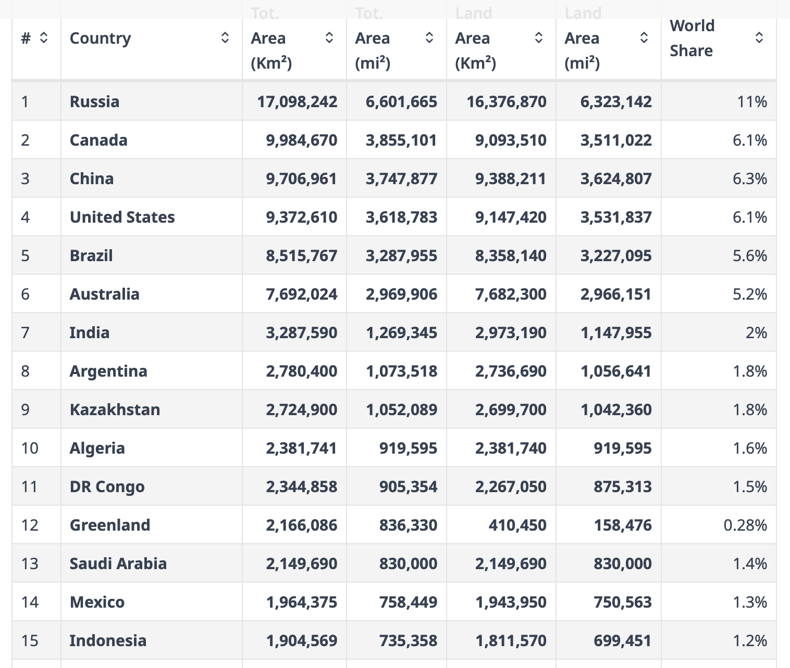
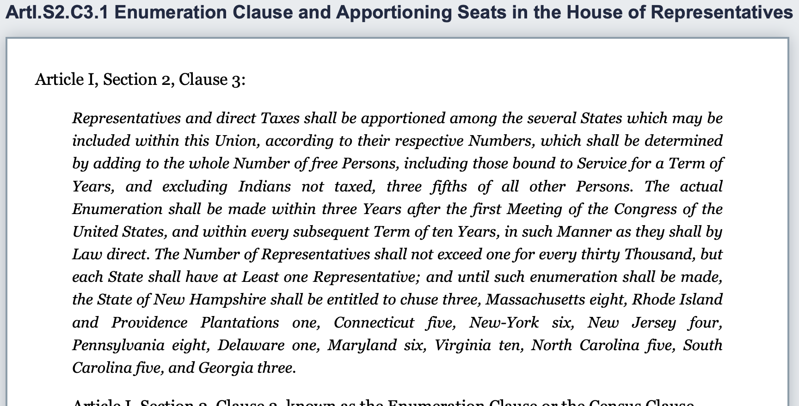
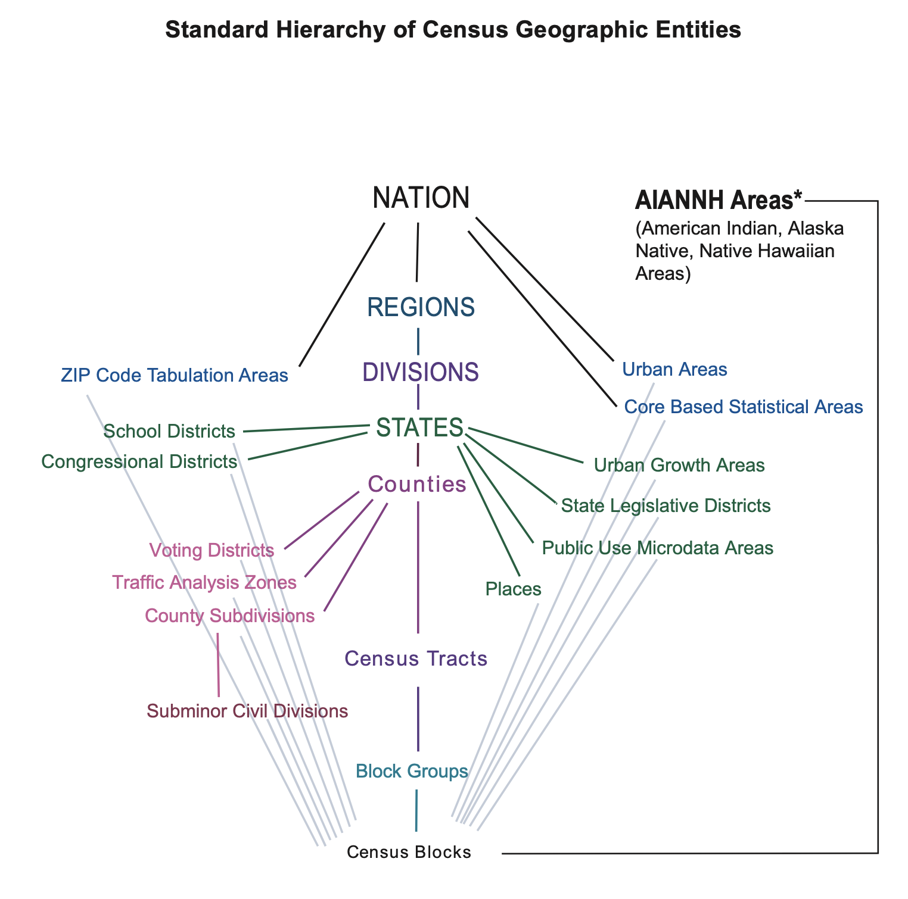
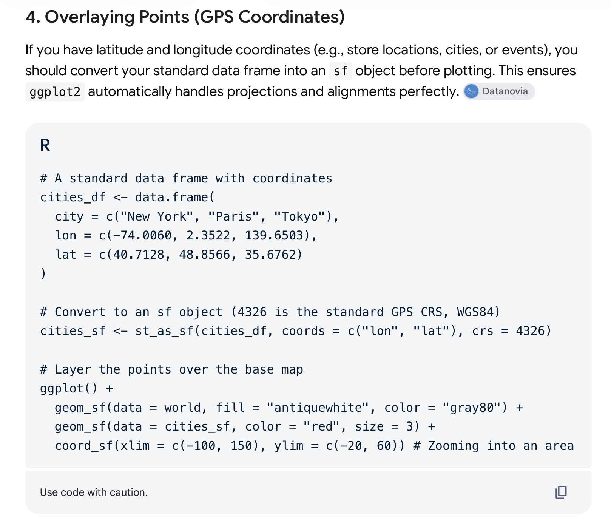

# Prelude

## Announcements

- [Exercise-05](../exercises/ex-05-tidy-data.qmd) | [ *Canvas dropbox*](https://psu.instructure.com/courses/2484925/assignments/18779443)  *due* on Friday, October 30, 2026.

## Last week...

- Critiquing figures
- Storytelling with data
- [Tutorial](../tutorials/tutorial-tidying-data.qmd) on tidy data; supports work on [Exercise-05](../exercises/ex-05-tidy-data.qmd).

## Today

- Making maps with data: Part I
  - General considerations
  - Making maps in R

# General considerations

## What are maps?

::: {.incremental}
- Visualizations of spatial relationships
- Terrestrial
- Astronomical
- Fantastical
:::

---

![The night sky from State College in October, 2026. Sky & Telescope^[<https://skyandtelescope.org/interactive-sky-chart/>]](../include/img/sky-telescope-oct-2026.png){#fig-october-2026-sky}

---

![A map of Tolkien's Middle Earth^[<https://static.wikia.nocookie.net/pjmidearthfilms/images/a/a2/Middle_Earth_map.jpg/revision/latest?cb=20230517165953>].](../include/img/middle-earth-map.png){#fig-middle-earth}

## History

:::: {.columns}
::: {.column width=50%}
- May be > 25K old!
- @Wikipedia-contributors2026-pj
- Earliest data visualizations?
:::
::: {.column width=50%}
![The oldest surviving map? Wikipedia^[By Zde - Own work, CC BY-SA 4.0, https://commons.wikimedia.org/w/index.php?curid=69695100]](https://upload.wikimedia.org/wikipedia/commons/4/42/Engraving_on_a_mammoth_tusk%2C_map%2C_Gravettian%2C_076872x.jpg?utm_source=en.wikipedia.org&utm_campaign=imageinfo&utm_content=thumbnail_unscaled){#fig-wikipedia-oldest-map}
:::
::::

## Geometric considerations

- Frame of reference
- Coordinate system
- Projection
  - 3D $\rightarrow$ 2D

---

{#fig-wilke-fig-15.1 width="55%"}

---

{#fig-wilke-fig-15.2 width="65%"}

## Equal Earth projection

![Wikipedia^[By Strebe - Own work, CC BY-SA 4.0, https://commons.wikimedia.org/w/index.php?curid=72769307]](https://upload.wikimedia.org/wikipedia/commons/6/61/Equal_Earth_projection_SW.jpg?utm_source=en.wikipedia.org&utm_campaign=imageinfo&utm_content=thumbnail_unscaled){#fig-equal-earth-static}

---

![Wikipedia^[By Dariusz Kowalczyk - Own workThis map was created with Generic Mapping Tools.(version 6.8.0_2026.09.21, only frames, animation created with GIF Movie Gear), CC BY-SA 4.0, https://commons.wikimedia.org/w/index.php?curid=200664498]](https://upload.wikimedia.org/wikipedia/commons/9/99/Mercator_and_Equal_Earth_projections%2C_animated_GIF.gif?utm_source=en.wikipedia.org&utm_campaign=parser&utm_content=thumbnail_unscaled){#fig-equal-earth-gif width="40%"}

## Equal Earth projection

- United Nations adopted a resolution on September 4, 2026 to phase out use of the Mercator projection in favor of the Equal Earth, and similar equal-area projections.
- 164 nations voted yes; 6 abstained; the U.S. voted no.
- Data visualizations can be, and often are, political matters.

---

### The U.S. is the ___ largest country in the world by *area*.

- 1st
- 2nd
- 3rd
- 4th
- 5th

## Largest countries by area

::: {.fragment}

:::

---

{#fig-wilke-fig-15.3}

---

{#fig-wilke-fig-15.5 width="65%"}

---

{#fig-wilke-fig-15.6 width="75%"}

---

{#fig-wilke-fig-15.6 width="75%"}

## Coordinates

:::: {.columns}
::: {.column width=50%}
- Latitude & longitude
- Landmass
- Continent
- Country
:::
::: {.column width=50%}
- State/Province
- County/Region
- City
- Zip
:::
::::

## Coordinates: Natural

:::: {.columns}
::: {.column width=50%}
- Latitude & longitude
- **Landmass**
- Continent
- Country
:::
::: {.column width=50%}
- State/Province
- County/Region
- City
- Zip
:::
::::

## Coordinates: Continuous

:::: {.columns}
::: {.column width=50%}
- **Latitude & longitude**
- Landmass
- Continent
- Country
:::
::: {.column width=50%}
- State/Province
- County/Region
- City
- Zip
:::
::::

## U.S. Census

- Required under the U.S. Constitution

::: {.fragment}

{#fig-enumeration-clause width="65%"}

:::


## U.S. Census: Geometry

:::: {.columns}
::: {.column width=50%}
- Nation
- State
- County
:::
::: {.column width=50%}
- Census Tract
- Census Block group
- Census Block
:::
::::

## U.S. Census

{#fig-census-geocoding width="45%"}

---

{#fig-census-geocoding-arcgis}

## U.S. Census: Preserving privacy

:::: {.columns}
::: {.column width=50%}
- Nation
- State
- County
:::
::: {.column width=50%}
- Census Tract
- Census Block group
- Census Block
:::
::::

## U.S. Census: Preserving privacy

:::: {.columns}
::: {.column width=50%}
- **Nation**
- **State**
- ~~County~~
:::
::: {.column width=50%}
- ~~Census Tract~~
- ~~Census Block group~~
- ~~Census Block~~
:::
::::

## Layers

{#fig-wilke-15.8 width="65%"}

---

{#fig-wilke-15.9 width="65%"}

## Choropleths

- Quantities $\rightarrow$ location

---

{#fig-wilke-15.11 width="65%"}

---

{#fig-wilke-15.13 width="65%"}

# Making maps in R

## Install & load packages

```{r}
#| echo: true
library(sf)
library(ggplot2)
library(rnaturalearth)
library(readr)
library(dplyr)
```

## Help from search/AI

{#fig-help-ai width="55%"}

## Map with coordinates: World

```{r}
#| label: fig-fetch-world-map
#| echo: true
# Fetch world map data as an 'sf' object
world <- ne_countries(scale = "medium", returnclass = "sf")

# Plot the map
ggplot(data = world) +
  geom_sf()
```

## Map with coordinates: Cities

```{r}
#| label: plot-basic-map
#| echo: true
# A standard data frame with coordinates
cities_df <- data.frame(
  city = c("New York", "Paris", "Tokyo"),
  lon = c(-74.0060, 2.3522, 139.6503),
  lat = c(40.7128, 48.8566, 35.6762)
)

# Convert to an sf object (4326 is the standard GPS CRS, WGS84)
cities_sf <- st_as_sf(cities_df, 
                      coords = c("lon", "lat"), crs = 4326)
```

---

```{r}
#| label: fig-three-cities
#| echo: true
# Layer the points over the base map
ggplot() +
  geom_sf(data = world, fill = "antiquewhite", color = "gray80") +
  geom_sf(data = cities_sf, color = "red", size = 3) +
  coord_sf(xlim = c(-100, 150), ylim = c(-20, 60))
```

## Getting data about states

```{r}
#| label: get-states
#| echo: true
us_states <- ne_states(country = "United States of America")
```

## Plot my location

```{r}
#| label: fig-my-location
#| echo: true
cities_df <- data.frame(
  city = c("State College"),
  lon = c(-77.84922),
  lat = c(40.79766)
)

# Convert to an sf object (4326 is the standard GPS CRS, WGS84)
cities_sf <- st_as_sf(cities_df, coords = c("lon", "lat"), crs = 4326)
```

## Plot my location

```{r}
#| label: fig-state-college
#| echo: true
ggplot() +
  geom_sf(data = us_states,
          fill = "antiquewhite",
          color = "gray80") +
  geom_sf(data = cities_sf,
          color = "red",
          size = 1) +
  coord_sf(xlim = c(-80.5, -74.8), ylim = c(39.5, 42.5)) # Zooming into an area
```

## Introducing: Exercise 06

- Map-maker, map-maker, [make me a map](../exercises/ex-06-making-maps.qmd)...
- Due Monday, November 16, 2026.

# Wrap up

## Main points

- Making maps involves multiple considerations
- Projections, coordinates/scale, geometries, layers
- Map-making often controversial
- Using R to make maps makes them reproducible (to you, others)

## Next time

- Making maps with data: Part II

# Resources

## About

This talk was produced using [Quarto](https://quarto.org), using the [RStudio](https://posit.co/products/open-source/rstudio/)
Integrated Development Environment (IDE), version 2026.10.0.233.

The source files are in R and R Markdown, then rendered to HTML using the
[revealJS](https://revealjs.com) framework.
The HTML slides are hosted in a [GitHub repo](https://github.com/psu-psychology/psych-490-data-viz-2026-fall) and served by GitHub pages at:
<https://psu-psychology.github.io/psych-490-data-viz-2026-fall>

## References
