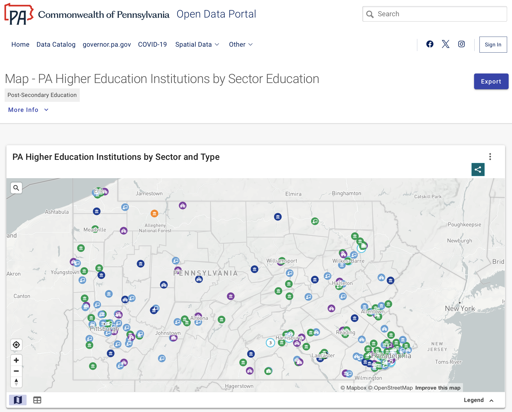

# Prelude

## Announcements

## Last time...

- Making maps with data: Part I

## Today

- Making maps with data: Part II

# Map making

## Setup

```{r}
#| label: setup
#| echo: true
#| code-fold: false
library(sf)
library(rnaturalearth)
library(rnaturalearthdata)
library(rnaturalearthhires)
library(tigris)
library(ggplot2)
library(readr)
library(dplyr)
```

## Gathering data

{#fig-data-pa-gov width="65%"}

## Gathering data

{#fig-pa-higher-ed-data}

## Import as CSV

```{r}
#| label: import-higher-ed-data
#| echo: true
#| code-fold: false
pa_higher_ed <- readr::read_csv("../include/xlsx/PA_Higher_Education_Institutions_by_Sector_Current_Statewide_Education_20261015.csv", show_col_types = FALSE)

summary(pa_higher_ed)
```

## Clean data

```{r}
#| label: trim-higher-ed
#| echo: true
#| code-fold: false
pa_higher_ed_trimmed <- pa_higher_ed |>
  rename(lon = Longitude,
         lat = Latitude) |>
  select(Sector, College, Type, County, lon, lat) |>
  filter(!is.na(lat) &
         !is.na(lon))
```

## Convert to sf

```{r}
#| label: convert-higher-ed-data
#| echo: true
#| code-fold: false
# Convert to an sf object (4326 is the standard GPS CRS, WGS84)
pa_higher_ed_sf <-
  sf::st_as_sf(
    x = pa_higher_ed_trimmed,
    coords = c("lon", "lat"),
    crs = 4326
  )
```

## Acquire base map

```{r}
#| label: get-states
#| echo: true
#| code-fold: false
us_states <- ne_states(country = "United States of America")
```

## Make the plot

```{r}
#| label: fig-pa-higher-ed
#| fig-cap: "A map of the locations of institutions of higher education in Pennsylvania from data.pa.gov."
#| echo: true
#| code-fold: false
#| output-location: slide
ggplot() +
  geom_sf(data = us_states, fill = "antiquewhite", color = "gray80") +
  geom_sf(data = pa_higher_ed_sf, aes(color = Sector), size = 1) +
  coord_sf(xlim = c(-80.5, -74.8), ylim = c(39.5, 42.5)) # Zooming into an area
```

## Compare to the State's

{#fig-pa-higher-ed-map width="60%"}

## Choropleths

:::: {.columns}
::: {.column width=50%}
- Statistical thematic map [@Wikipedia-contributors2026-qf]
- Data element maps to fill shading or color 
- First known example 1826
- Term comes from the Greek for "multitude of regions"
:::
::: {.column width=50%}
![Charles Dupin's 1826 map. Wikipedia^[By Charles Dupin - http://math.yorku.ca/SCS/Gallery/images/dupin1826-map_200.jpg, Public Domain, https://commons.wikimedia.org/w/index.php?curid=29383521]](https://upload.wikimedia.org/wikipedia/commons/3/38/Carte_figurative_de_l%27instruction_populaire_de_la_France.jpg?utm_source=en.wikipedia.org&utm_campaign=imageinfo&utm_content=thumbnail_unscaled)
:::
::::

---

![Wikipedia^[By Derek Montaño - Own work, CC BY-SA 3.0, https://commons.wikimedia.org/w/index.php?curid=25660032]](https://upload.wikimedia.org/wikipedia/commons/e/e9/Choropleth_Map.png?utm_source=en.wikipedia.org&utm_campaign=imageinfo&utm_content=thumbnail_unscaled)

---

<iframe src="https://ourworldindata.org/grapher/population-density?tab=map" loading="lazy" style="width: 100%; height: 600px; border: 0px none;" allow="web-share; clipboard-write"></iframe>

---

<iframe src="https://ourworldindata.org/explorers/food-prices?Diet=Healthy+diet&Cost+or+Affordability=Affordability&Affordability+metric=Share+that+cannot+afford&country=NGA~BGD~IND~ETH~MEX~USA~BRA~GBR&tab=map&hideControls=false" loading="lazy" style="width: 100%; height: 696px; border: 0px none;" allow="web-share; clipboard-write"></iframe>

---

<iframe src="https://ourworldindata.org/explorers/plastic-pollution?Metric=Plastic+waste+generation&Per+capita=false&Share+of+world+total=false&Source=Jambeck+et+al.+%282015%29&country=USA~CHN~IND&tab=map&hideControls=false" loading="lazy" style="width: 100%; height: 696px; border: 0px none;" allow="web-share; clipboard-write"></iframe>

---

<iframe src="https://ourworldindata.org/grapher/migrant-populations?metric=immigrants&unit=number&tab=map&hideControls=false" loading="lazy" style="width: 100%; height: 674px; border: 0px none;" allow="web-share; clipboard-write"></iframe>

# Making choropleth maps

---

```{r}
#| label: get-world-map
#| echo: true
#| code-fold: false
# Load country shapes (excluding Antarctica for a cleaner view)
world_map <- ne_countries(scale = "medium", returnclass = "sf") %>% 
  filter(name != "Antarctica")
```

---

```{r}
#| label: fig-gdp-map
#| echo: true
#| code-fold: false
#| output-location: slide
ggplot(data = world_map) +
  # Map the color fill to GDP, and draw light white borders between regions
  geom_sf(aes(fill = gdp_md), color = "white", size = 0.1) +
  
  # Apply a colorblind-friendly continuous color scale
  scale_fill_viridis_c(name = "GDP (Millions)", labels = scales::comma_format()) +
  
  # Remove background grid lines and latitude/longitude labels
  theme_void() +
  
  # Add titles
  labs(title = "Global GDP Choropleth Map",
       subtitle = "Created using ggplot2 and sf in R",
       caption = "Source: Natural Earth") +
  
  # Position the legend at the bottom
  theme(legend.position = "bottom")
```

## Higher ed data

- Get the county geo data from the *tigris* package

```{r}
#| label: gather-tigris-county-data
#| echo: true
#| code-fold: false
#| message: false
pa_county_sf <- counties(state = "PA", cb = TRUE, class = "sf")
```

## Higher ed data

- Summarize the data

```{r}
#| label: summarize-tigris-county-data
#| echo: true
#| code-fold: false
pa_county_sf |> summary()
```

## Higher ed data

- Inspect `NAME` variable.

```{r}
#| label: inspect-county-sf-name
#| echo: true
#| code-fold: false
pa_county_sf$NAME |> sort()
```

## Higher ed data

- Compare with data from the PA gov

```{r}
#| label: compare-higher-ed-data
#| echo: true
#| code-fold: false
pa_higher_ed_trimmed$County 
```

## Higher ed data

- Pick *unique* values and sort them

```{r}
#| label: compare-higher-ed-data-sorted
#| echo: true
#| code-fold: false
pa_higher_ed_trimmed$County |> unique() |> sort()
```

## Higher ed data

- Summarize the number of institutions per county

```{r}
#| label: summarize-n-institutions-per-county
#| echo: true
#| code-fold: false
pa_higher_ed_counties <- pa_higher_ed_trimmed |>
  group_by(County) |>
  summarize(n_institutions = n())
```

## Higher ed data

- Merge (join) the databases based on the variable(s) that match

```{r}
#| label: join-datasets
#| echo: true
#| code-fold: false
pa_map_sf <- left_join(pa_county_sf, 
                       pa_higher_ed_counties, 
                       join_by(NAME == County))
```

## Higher ed data

- Make the map

```{r}
#| label: fig-higher-ed-map-v1
#| echo: true
#| code-fold: false
#| 
ggplot(data = pa_map_sf) +
  geom_sf(aes(fill = n_institutions), color = "white", size = 0.1) +
  # scale_fill_viridis_c(option = "plasma", name = "Value") +
  theme_void() +
  labs(
    title = "County-Level Choropleth Map",
    subtitle = "PA Counties Colored by number of higher ed institutions",
    caption = "Source: U.S. Census Bureau / tigris"
  )
```

## Higher ed data

- Make a histogram to see the distribution

```{r}
#| label: fig-institutions-histogram
#| echo: true
#| code-fold: false
#| output-location: slide
ggplot(data = pa_map_sf) +
  aes(x = n_institutions) +
  geom_histogram()
```

## Higher ed data

- Create a nominal (ordinal) variable with tiers based on the number of institutions

```{r}
#| label: create-institution-tiers
#| echo: true
#| code-fold: false
pa_map_sf_tiers <- pa_map_sf |>
  mutate(
    tier = case_when(
      is.na(n_institutions) ~ "none",
      n_institutions <= 5 ~ "<=5",
      n_institutions <= 10 ~ "6-10",
      n_institutions <= 15 ~ "11-15",
      n_institutions < 21 ~ "16-20"
    )
  ) |>
  mutate(tier = ordered(tier, 
                        levels = c("none", "<=5", "6-10", 
                                   "11-15", "16-20")))
```

## Higher ed data

- Plot the data by tier

```{r}
#| label: fig-map-institution-tiers
#| echo: true
#| code-fold: false
#| output-location: slide

pa_map_sf_tiers |>
ggplot() +
  geom_sf(aes(fill = tier), color = "white", size = 0.1) +
  # scale_fill_viridis_c(option = "plasma", name = "Value") +
  theme_void() +
  labs(
    title = "County-Level Choropleth Map",
    subtitle = "PA Counties Colored by number of higher ed institutions",
    caption = "Source: U.S. Census Bureau / tigris"
  )
```

## Why might *psychologists* care about making maps?

# Wrap up

## Main points

- Maps as figures require
  - Data about geographic entity boundaries, names or IDs
  - Data about properties associated with geographic entities
  - Map location data or statistical data linked to location
- R packages: *sf*, *tigris*, *rnaturalearth*, *rnaturalearthdata*, *rnaturalearthhires*

## Next time

- Work session

# Resources

## About

This talk was produced using [Quarto](https://quarto.org), using the [RStudio](https://posit.co/products/open-source/rstudio/)
Integrated Development Environment (IDE), version 2026.10.0.233.

The source files are in R and R Markdown, then rendered to HTML using the
[revealJS](https://revealjs.com) framework.
The HTML slides are hosted in a [GitHub repo](https://github.com/psu-psychology/psych-490-data-viz-2026-fall) and served by GitHub pages at:
<https://psu-psychology.github.io/psych-490-data-viz-2026-fall>

## References
