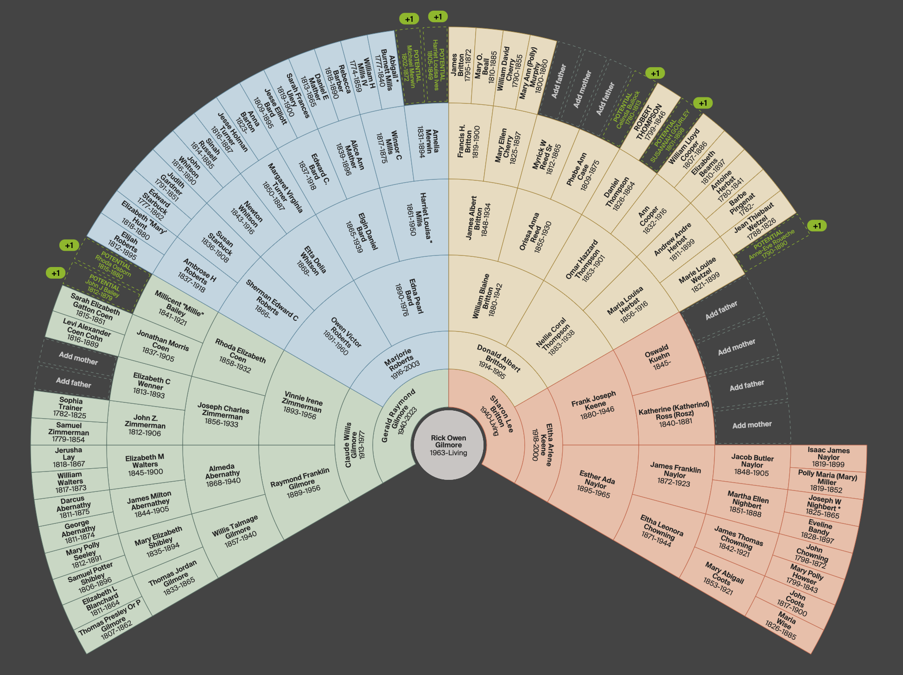

# Prelude

## Announcements

- [Exercise-05](../exercises/ex-05-tidy-data.qmd) | [ *Canvas dropbox*](https://psu.instructure.com/courses/2484925/assignments/18779443) due next Friday, October 30, 2026.
- [Exercise-06](../exercises/ex-06-making-maps.qmd) | [ *Canvas dropbox*](https://psu.instructure.com/courses/2484925/assignments/18789309) due Monday, November 16, 2026.
- [Tutorial](../tutorials/tutorial-more-ggplot2.qmd) on modifying and enhancing *ggplot2* figures in useful ways.

## Last time...

:::: {.columns}

::: {.column width=50%}
- Making maps with data: Part II
  - Locations

:::

::: {.column width=50%}
 from 2026-10-21.](include/fig/fig-pa-higher-ed-1.png){#fig-point-map-higher-ed}

:::

::::

## Last time...

:::: {.columns}

::: {.column width=50%}
- Making maps with data: Part II
  - Locations
  - Choropleths

:::

::: {.column width=50%}
 from 2026-10-21.](include/fig/fig-map-institution-tiers-1.png){#fig-choropleth-higher-ed}

:::

::::

## Today's topics

- Maps in psychology
- Work session
  - [Exercise-05](../exercises/ex-05-tidy-data.qmd)
  - [Exercise-06](../exercises/ex-06-making-maps.qmd)
  - Final projects

# Maps in psychology

---

{#fig-gilmore-ancestry width="75%"}

## Brain imaging

:::: {.columns}
::: {.column width=50%}
{#fig-fmri}
:::
::: {.column width=50%}
{#fig-structural-mri}
:::
::::

## Statistical parametric maps

- Statistical test or measurement (*t*, *F*) $\rightarrow$ parameter 
- Parameter $\rightarrow$ location in the nervous system
- Frame of reference, coordinate system, data to map, color scheme
- A kind of choropleth

## Feeling emotion {.scrollable}

{#fig-nummenaa-2014-fig-1 width="75%"}

---

{#fig-nummenaa-2014-fig-2 width="75%"}

## Under the hood

- Locations on body outline + 
- Valence (increase/decrease) in sensation $\rightarrow$ "activation"
- Combined over participants $\rightarrow$ color scheme

---

<iframe src="https://ourworldindata.org/grapher/share-who-report-lifetime-anxiety-or-depression?tab=map" loading="lazy" style="width: 100%; height: 600px; border: 0px none;" allow="web-share; clipboard-write"></iframe>

# Work session

# Wrap up

## Next time

- Tables

# Resources

## About

This talk was produced using [Quarto](https://quarto.org), using the [RStudio](https://posit.co/products/open-source/rstudio/)
Integrated Development Environment (IDE), version 2026.10.0.233.

The source files are in R and R Markdown, then rendered to HTML using the
[revealJS](https://revealjs.com) framework.
The HTML slides are hosted in a [GitHub repo](https://github.com/psu-psychology/psych-490-data-viz-2026-fall) and served by GitHub pages at:
<https://psu-psychology.github.io/psych-490-data-viz-2026-fall>

## References
