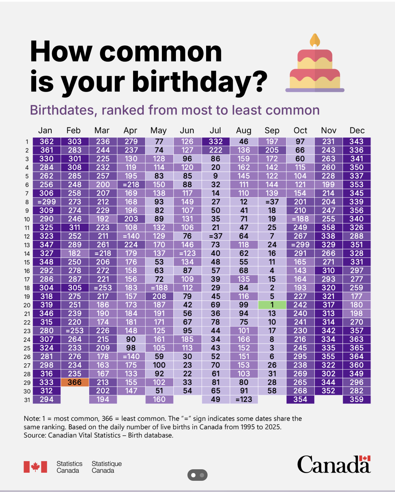
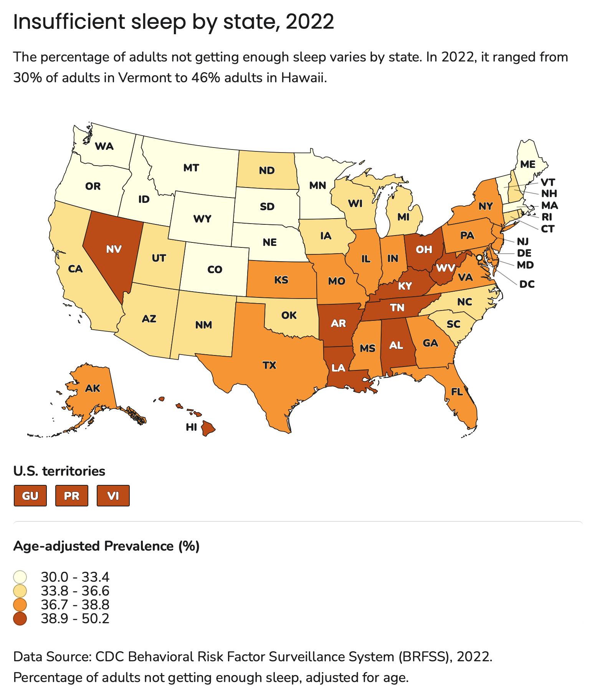
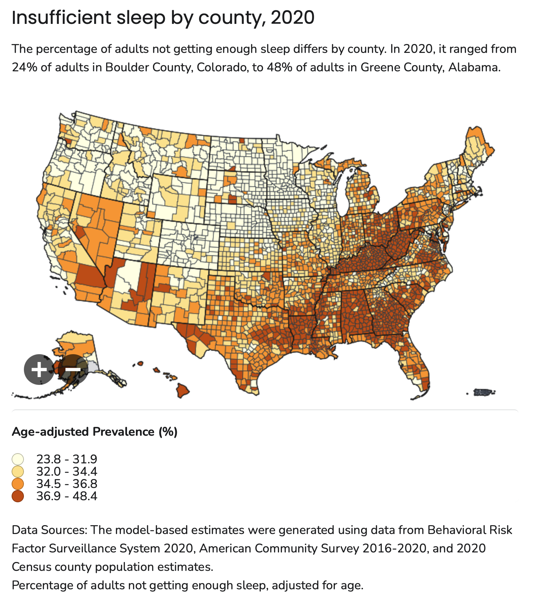
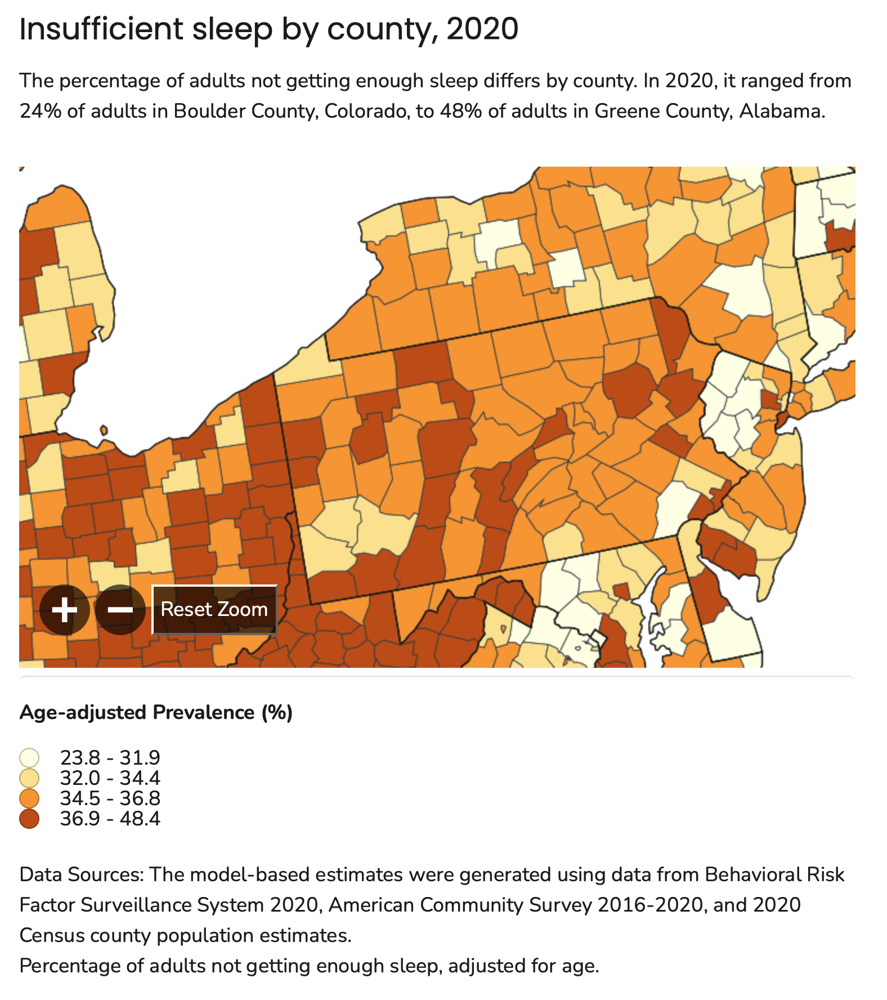
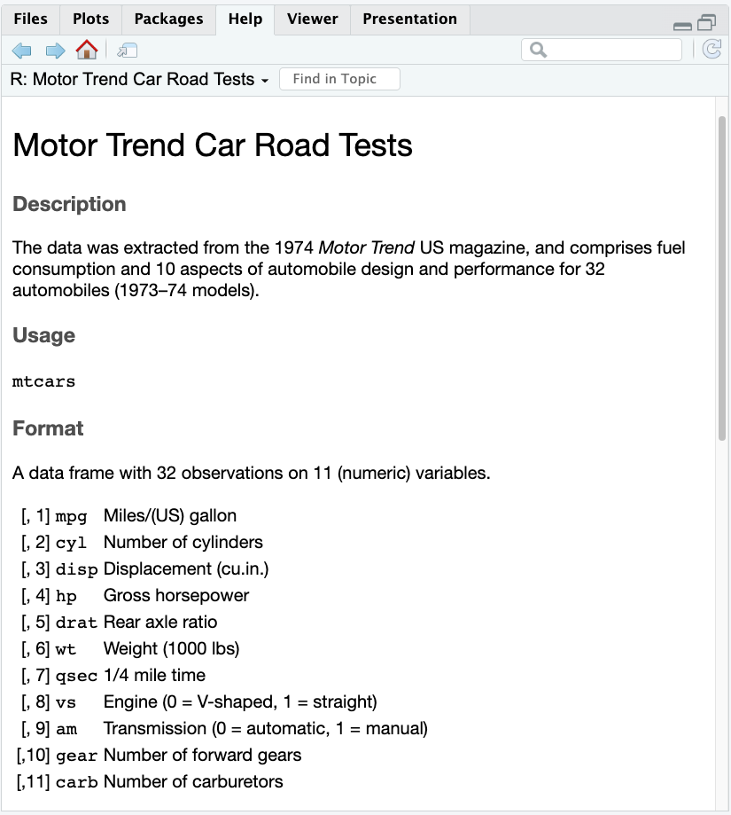

# Preliminaries

## {.scrollable}



## Maps!

:::: {.columns}
::: {.column width=50%}
{#fig-sleep-states width="65%"}
:::
::: {.column width=50%}
{#fig-sleep-all-counties width="65%"}
:::
::::

---

{#fig-sleep-pa width="45%"}

## Announcements

- [Exercise-05](../exercises/ex-05-tidy-data.qmd) | [ *Canvas dropbox*](https://psu.instructure.com/courses/2484925/assignments/18779443)  *Due* on Friday, October 30, 2026.
- [Exercise-06](../exercises/ex-06-making-maps.qmd) | [ *Canvas dropbox*](https://psu.instructure.com/courses/2484925/assignments/18789309)  *due* on Monday, November 16, 2026.

## Today's topics

- Background
- Making tables in base R

# Background

# Making tables

## Ingredients

- A tidy data frame
  - Named columns are variables
  - Rows are observations
- Start with base R: No additional packages

## Gathering data

:::: {.columns}
::: {.column width=40%}

- How about *mtcars*?

```{r}
#| eval: false
help("mtcars")
```

:::
::: {.column width=60%}
{#fig-mtcars-help width="65%"}
:::
::::

## Exploring data: `summary()`

```{r}
#| label: summary-mtcars
summary(mtcars)
```

## Exploring data: `str()`

```{r}
#| label: str-mtcars
str(mtcars)
```

## Considerations: Table type?

- Summary
  - Statistics
  - Cross-tabulations
- Raw data

## Basic table

```{r}
#| label: tbl-cyl
table(mtcars$cyl)
```

## Basic table

```{r}
#| label: tbl-disp
table(mtcars$disp)
```
## Lesson learned

- Basic tables work best with variables that are (or can be made to be) discrete (nominal or ordinal)

## Cross-tabulation

```{r}
#| label: tbl-cyl-gear
#| tbl-cap: "Number of cars in the *mtcars* dataset by the number of cylinders in the engine and the number of gears in the transmission."
mtcars |>
  dplyr::select(cyl, gear) |>
  table()
```
## Wait! You said Base R

- I did, but I wanted to select two variables from *mtcars*.
- The select function from *dplyr* does that easily.
- *Note:* These slides did not start with a setup chunk
  - So, no `library(dplyr)` statement
  - But I can access the *dplyr* commands with `dplyr::<command>`.

## Under the hood

- To make tables with titles and sequential numbers using Quarto...

```{{r}}
#| label: tbl-cyl-gear
#| tbl-cap: "Number of cars in the *mtcars* dataset by the number of cylinders in the engine and the number of gears in the transmission."
mtcars |>
  dplyr::select(cyl, gear) |>
  table()
```

- Give your R chunk a `label` starting with `tbl-`
- Add a `tbl-cap` for the caption
- Then you can link to the table, for example @tbl-cyl-gear

## Bottom line on `table()`

:::: {.columns}
::: {.column width=50%}
- A quick check of `help("table")` (@fig-help-table at right) shows
- `table()` is for making cross tabulations
- Or when you take all the data...
:::
::: {.column width=50%}
{#fig-help-table}
:::
::::

## Prettier output {.scrollable}

```{r}
#| label: tbl-formattable-mtcars
#| tbl-cap: "A prettier table of a subset of the *mtcars* dataset."
#| output-location: slide
formattable::formattable(head(mtcars, n = 6))
```

## A custom summary table

::: {#fig-custom-summary}

| variable  | min  | median | mean  | max   |
|-----------|------|--------|-------|-------|
| mpg       | 10.4 | 19.2   | 20.09 | 33.90 |
| disp      | 71.1 | 196.3  | 230.7 | 472.0 |
| ...       | ...  | ...    | ...   | ...   |  

A sketch of a statistical summary table we might want to create. 
:::

::: {.fragment}
- Need a different data frame
- Columns must be computed from *mtcars*
:::

## Under the hood

- @fig-custom-summary is built using Markdown tables.

::: {#fig-markdown-table-code}
````markdown
| variable  | min  | median | mean  | max   |
|-----------|------|--------|-------|-------|
| mpg       | 10.4 | 19.2   | 20.09 | 33.90 |
| disp      | 71.1 | 196.3  | 230.7 | 472.0 |
| ...       | ...  | ...    | ...   | ...   |  

````

A table built using the [Markdown tables](https://www.markdownguide.org/extended-syntax/#tables) syntax.
:::

## Making a summary table

```{r}
#| label: make-my_stats-df
#| code-line-numbers: "|1|2-3|4-5|6-7|8-9|11-15"
variables <- c("mpg", "disp")
mins <- c(min(mtcars$mpg), 
          min(mtcars$disp))
meds <- c(median(mtcars$mpg), 
          median(mtcars$disp))
means <- c(mean(mtcars$mpg), 
           mean(mtcars$disp))
maxs <- c(max(mtcars$mpg), 
          max(mtcars$disp))

my_stats_df <- data.frame(variable = variables,
                       min = mins,
                       median = meds,
                       mean = means,
                       max = maxs)
```

## Show it

```{r}
#| label: tbl-show-my_stats_df
#| tbl-cap: "A table showing summary statistics of two of the variables from the *mtcars* dataset."
formattable::format_table(my_stats_df)
```

## Another way to show it

- The *kableExtra* package has many features for making HTML-format tables.
- You could try making a table if you choose to work on [Exercise 05](../exercises/ex-05-tidy-data.qmd).

```{r}
#| label: tbl-show-my_stats_df-kable
#| tbl-cap: "A table showing summary statistics of two of the variables from the *mtcars* dataset. It uses the *kableExtra* package."
#| output-location: slide
#| code-line-numbers: "|1|2|3"
my_stats_df |>
  kableExtra::kable() |>
  kableExtra::kable_classic()
```


## Some take-homes

- Data frames are useful and flexible structures
- The custom summary table is similar to the data dictionary we made in the [Tidying Data tutorial](../tutorials/tutorial-tidying-data.qmd#cleaning).

# Wrap-up

## Main points

- Tables can be informative accompaniments to figures
- Data frames are useful and flexible structures for making both
- Think about the *kind* of table you want to produce
- Making pretty tables in R can be done; we're getting there
- *Scripting* the generation of tables makes them less error-prone

## Next time

- Tables in *gt*

# Resources

## About

This talk was produced using [Quarto](https://quarto.org), using the [RStudio](https://posit.co/products/open-source/rstudio/)
Integrated Development Environment (IDE), version 2026.10.0.233.

The source files are in R and R Markdown, then rendered to HTML using the
[revealJS](https://revealjs.com) framework.
The HTML slides are hosted in a [GitHub repo](https://github.com/psu-psychology/psych-490-data-viz-2026-fall) and served by GitHub pages at:
<https://psu-psychology.github.io/psych-490-data-viz-2026-fall>

## References