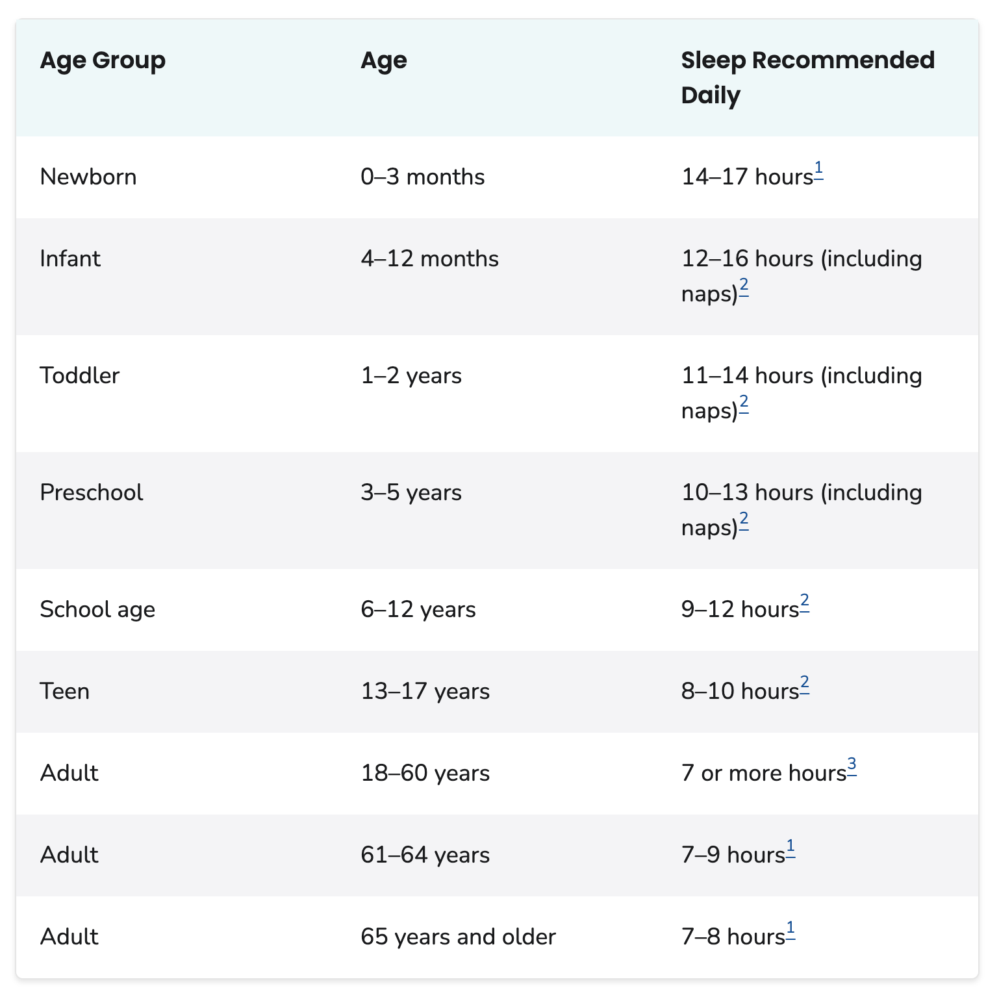

# Preliminaries

## More sleep

{#fig-cdc-sleep-recs}

---

```{r}
#| echo: false
library(ggplot2)
library(dplyr)
cdc_sleep <- readr::read_csv("../include/csv/cdc-sleep-recs.csv", show_col_types = FALSE)
```

```{r}
#| label: fig-cdc-sleep-recs
#| fig-cap: "Figure based on @CDC2025-ty"
#| output-location: slide
#| code-line-numbers: "|1|2-3|4|5-6|7-8|9|10-13"
cdc_sleep |>
  mutate(hrs = (hrs_min + hrs_max)/2,
         age = (age_min + age_max)/2) |>
  ggplot() +
  geom_errorbar(aes(x = age, ymin = hrs_min, 
                    ymax = hrs_max), width = 0.2, color = "gray40") +
  geom_errorbarh(aes(y = hrs, xmin = age_min, 
                     xmax = age_max), height = 0.2, color = "gray40") +
  geom_smooth(aes(x = age, y = hrs), se = FALSE) +
  theme_minimal() +
  ylim(0,17) +
  labs(title = "Daily sleep recommendations across age.", 
       caption = "Source: U.S. Centers for Disease Control.")
```

## Announcements

- [Exercise-05](../exercises/ex-05-tidy-data.qmd) | [ *Canvas dropbox*](https://psu.instructure.com/courses/2484925/assignments/18779443)  *Due* on Friday, October 30, 2026.
- [Exercise-06](../exercises/ex-06-making-maps.qmd) | [ *Canvas dropbox*](https://psu.instructure.com/courses/2484925/assignments/18789309)  *due* on Monday, November 16, 2026.

## Today's topics

- Making (better) tables

# Making (better) tables

## Package *gt*

{#fig-parts-of-gt-table}

## *gt* tutorial

- Gather data
- Format it as a 'tibble', a special type of data frame

https://gt.rstudio.com/articles/gt.html

## Setup

```{r}
#| label: setup
library(gt)
library(dplyr)
library(tibble)
```

## Gathering & formatting

```{r}
#| label: gather-islands
#| code-line-numbers: "|1|2-5|6"
islands_tbl <-
  tibble(
    name = names(islands),
    size = islands
  ) |>
  slice_max(size, n = 10)
```

## Inspecting

```{r}
#| label: inspecting-islands
islands_tbl
```

## Display islands

```{r}
#| label: tbl-islands-gt
#| output-location: slide
# Create a display table showing ten of
# the largest islands in the world
gt_tbl <- gt(islands_tbl)

# Show the gt Table
gt_tbl
```

https://gt.rstudio.com/articles/gt.html

## Adorn the table: Header

```{r}
#| label: tbl-islands-header
#| tbl-cap: "A table of the 'islands' data with a header."
#| output-location: slide
#| code-line-numbers: "|3-4|5-8|11"
# Make a display table with the `islands_tbl`
# table; put a heading just above the column labels
gt_tbl <-
  gt_tbl |>
  tab_header(
    title = "Large Landmasses of the World",
    subtitle = "The top ten largest are presented"
  )

# Show the gt Table
gt_tbl
```

## An aside about markdown

```markdown
Here is some text in *italics*.
Here is some text in **boldface**.
Here is some text with ~~strike-through formatting.~~ 
Here is a footnote^[Some additional information.]
```

::: {.fragment}
Here is some text in *italics*. \
Here is some text in **boldface**. \
Here is some text with ~~strike-through formatting.~~ \
Here is a footnote^[Some additional information.]
:::

## Style the header

```{r}
#| label: tbl-islands-header-styled
#| tbl-cap: "A table of the 'islands' data with a header styled using markdown. Notice that the title is in **boldface** and the subtitle has some words in *italics*."
#| output-location: slide
#| code-line-numbers: "|3|4-7"
# Use markdown for the heading's `title` and `subtitle` to
# add bold and italicized characters
gt(islands_tbl[1:2, ]) |>
  tab_header(
    title = md("**Large Landmasses of the World**"),
    subtitle = md("The *top two* largest are presented")
  )
```

## Wait a second

- What does that square brackets business do?

:::: {.columns}
::: {.column width=50%}
```{r}
gt(islands_tbl)
```

:::
::: {.column width=50%}
```{r}
gt(islands_tbl[1:2, ])
```
:::
::::

## Add a source note

```{r}
#| label: tbl-islands-with-source-note
#| tbl-cap: "A table of the 'islands' data with a source note."
#| output-location: slide
#| code-line-numbers: "|3-4|5-7|8-10|13"
# Display the `islands_tbl` data with a heading and
# two source notes
gt_tbl <-
  gt_tbl |>
  tab_source_note(
    source_note = "Source: The World Almanac and Book of Facts, 1975, page 406."
  ) |>
  tab_source_note(
    source_note = md("Reference: McNeil, D. R. (1977) *Interactive Data Analysis*. Wiley.")
  )

# Show the gt table
gt_tbl
```

## Another example

:::: {.columns}
::: {.column width=50%}
- Palmer penguins
- @horst_hill_penguins
:::
::: {.column width=50%}

:::
::::


## Gathering data: Palmer pe

```{r}
penguins |> head()
```

## Exploring data: `summary()`

```{r}
#| label: summary-penguins
summary(penguins)
```

## Exploring data: `str()`

```{r}
#| label: str-penguins
str(penguins)
```

## Selecting data

- Remember, we often want a continuous variable and one or more discrete (nominal or ordinal) variables

```{r}
penquins_island_sex_mass <- penguins |>
  select(island, body_mass, sex)
```

## Summarize

```{r}
#| label: make-tbl-penguins-data
#| code-line-numbers: "|1|2|3-7|8"
penguins_tbl <- penquins_island_sex_mass |>
  group_by(sex) |>
  summarize(sample_n = n(),
            mean = mean(body_mass),
            median = median(body_mass),
            min = min(body_mass),
            max = max(body_mass)) |>
  gt()
```

## Plot the table

```{r}
#| label: tbl-penguins
#| echo: true
#| code-fold: false
#| tbl-cap: "A summary table from the *penguins* dataset. Inspired by the *gt* package demo."
#| output-location: slide
#| code-line-numbers: "|1|2-5|8"
penguins_gt_tbl <- penguins_tbl |>
  tab_header(
    title = "Penguin mass by sex",
    subtitle = "This table needs a figure, don't you think?"
  )

# Show the gt Table
penguins_gt_tbl
```

# Wrap-up

## Main points

- Tables can be informative accompaniments to figures; sometimes more informative than figures.
- Data frames (or their cousins tibbles) are useful and flexible structures for making both
- Think about the *kind* of table you want to produce
- Making pretty tables in R can be done; *gt* makes it possible
- *Scripting* the generation of tables makes them less error-prone

## Next time

- Work session

# Resources

## About

This talk was produced using [Quarto](https://quarto.org), using the [RStudio](https://posit.co/products/open-source/rstudio/)
Integrated Development Environment (IDE), version 2026.10.0.233.

The source files are in R and R Markdown, then rendered to HTML using the
[revealJS](https://revealjs.com) framework.
The HTML slides are hosted in a [GitHub repo](https://github.com/psu-psychology/psych-490-data-viz-2026-fall) and served by GitHub pages at:
<https://psu-psychology.github.io/psych-490-data-viz-2026-fall>

## References