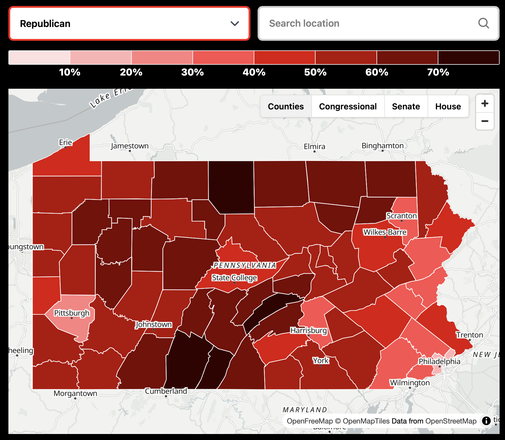
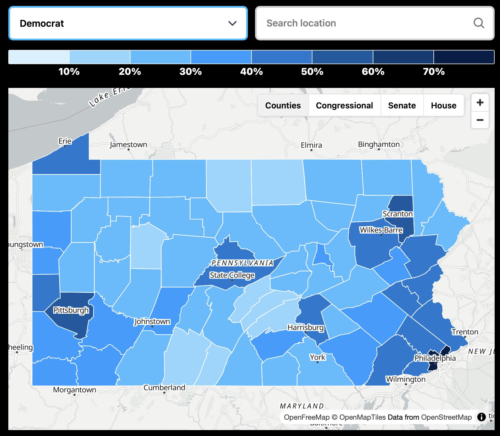
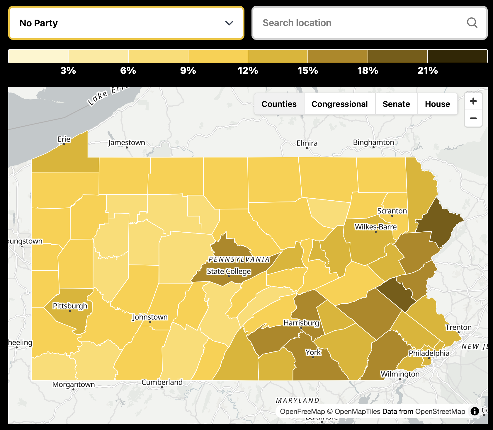
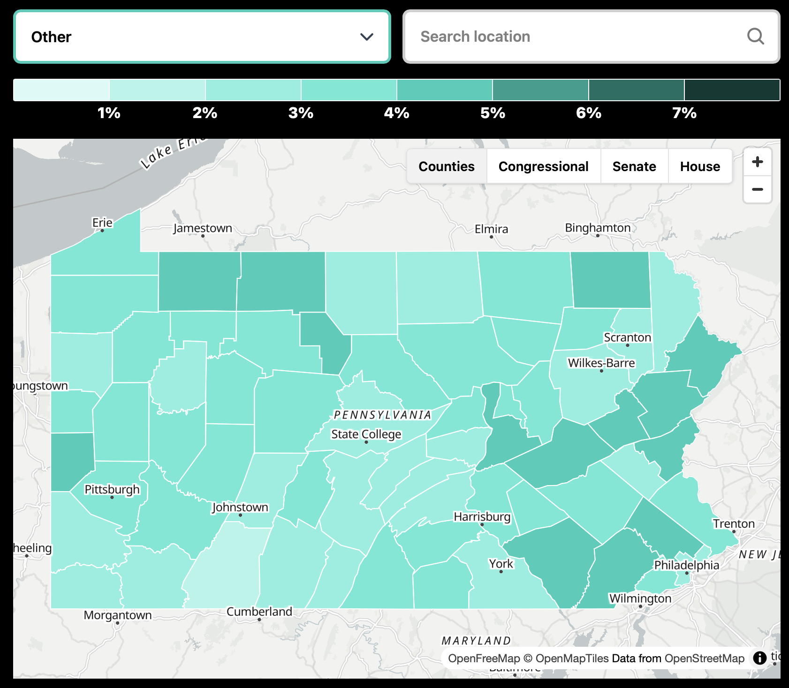
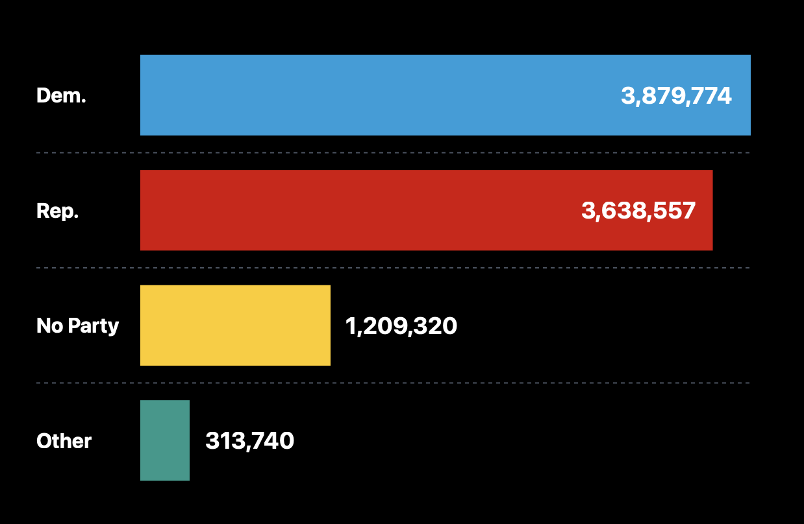
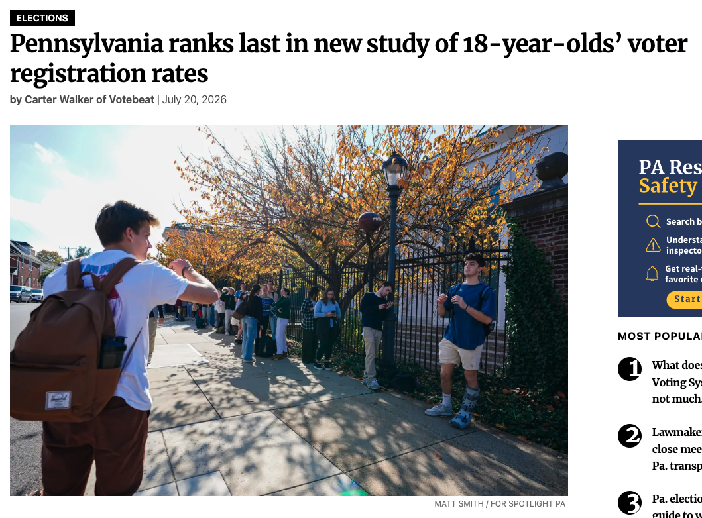
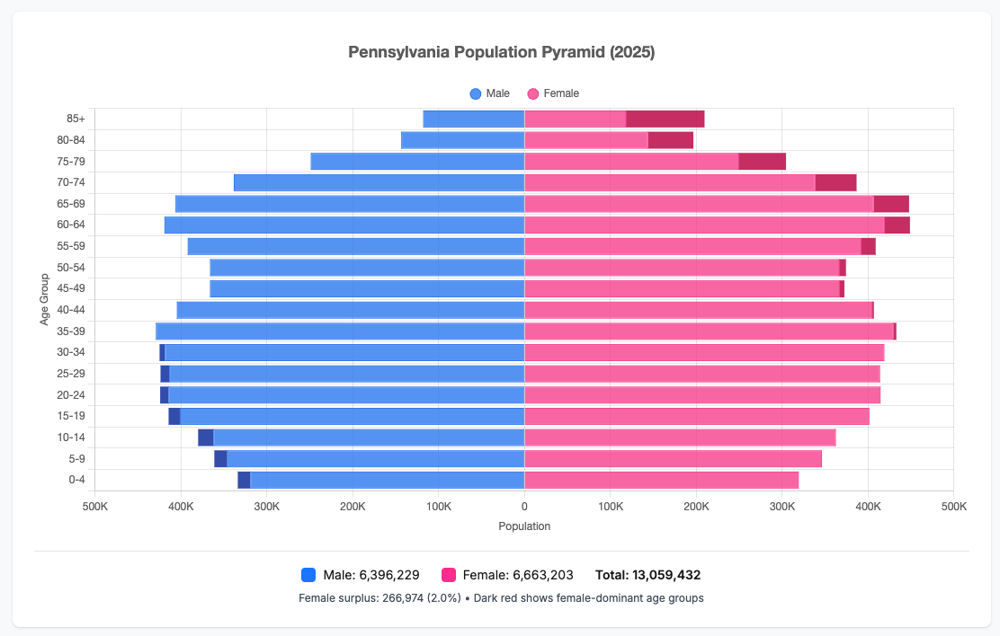
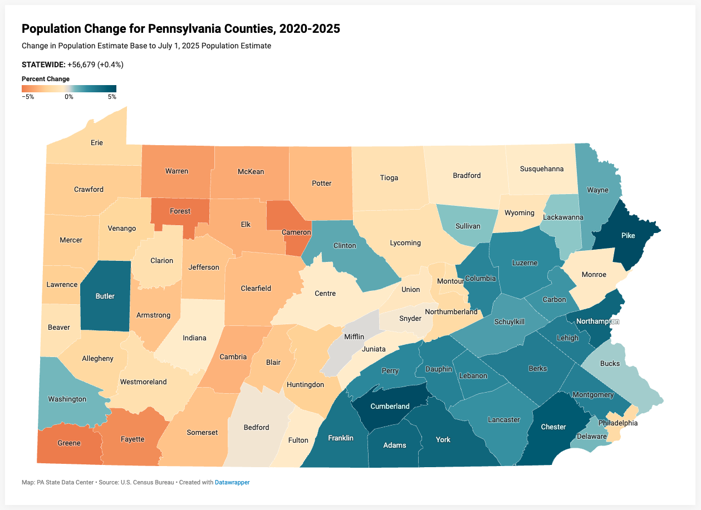

# Prelude

## Announcements

- [Exercise-06](../exercises/ex-06-making-maps.qmd) | [ *Canvas dropbox*](https://psu.instructure.com/courses/2484925/assignments/18789309) due Monday, November 16, 2026.

## Last time...

## Today's topics

- Voter registration
- Population

# Voter registration

## Republicans

{#fig-repub-reg width="55%"}

## Democrats

{#fig-dem-reg width="55%"}

## No party

{#fig-none-reg width="55%"}

## Other

{#fig-other-reg width="55%"}

## Summary

{#fig-voter-reg-summary width="65%"}

## Young people registrations

{#fig-registration-18-year-olds}

## 

{width="70%"}

## Why?

::: {.fragment}
>...it’s not the young people’s fault, said Laura Brill, CEO and Founder of The Civics Center.

:::

::: {.fragment}
>“It's not that young people in Michigan are so much more impassioned and and inherently organized than young people in Pennsylvania,” Brill said. “It's that they're involved in different systems and [have] different supports to help them do it.”

:::

---

>“Half of U.S. teens live in states where they can preregister at age 16, and what we are definitely seeing is that states with preregistration have higher registration rates for 18-year-olds, just because there's a bigger on-ramp for people to learn about it,” she said.

## Population

{#fig-pa-pop-pyramid width="65%"}

## Population changes

{#fig-pa-pop-changes width="65%"}

# Wrap up

## Next time

- Data visualization in politics

# Resources

## About

This talk was produced using [Quarto](https://quarto.org), using the [RStudio](https://posit.co/products/open-source/rstudio/)
Integrated Development Environment (IDE), version 2026.10.0.233.

The source files are in R and R Markdown, then rendered to HTML using the
[revealJS](https://revealjs.com) framework.
The HTML slides are hosted in a [GitHub repo](https://github.com/psu-psychology/psych-490-data-viz-2026-fall) and served by GitHub pages at:
<https://psu-psychology.github.io/psych-490-data-viz-2026-fall>

## References
