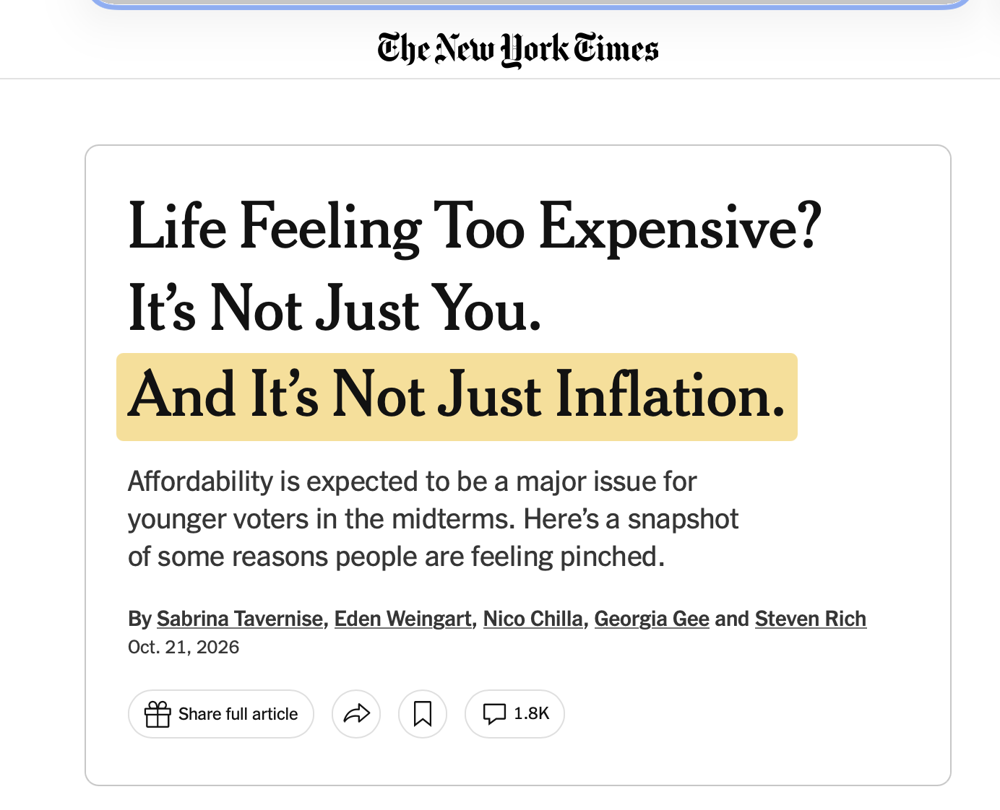

# Prelude

## In the news...

## Announcements

- [Exercise-06](../exercises/ex-06-making-maps.qmd) | [ *Canvas dropbox*](https://psu.instructure.com/courses/2484925/assignments/18789309) due Monday, November 16, 2026.

## Today's topics

- Work session
  - [Exercise-06](../exercises/ex-06-making-maps.qmd)
  - Final projects

# Work session

# Wrap up

## Next time

# Resources

## About

This talk was produced using [Quarto](https://quarto.org), using the [RStudio](https://posit.co/products/open-source/rstudio/)
Integrated Development Environment (IDE), version 2026.10.0.233.

The source files are in R and R Markdown, then rendered to HTML using the
[revealJS](https://revealjs.com) framework.
The HTML slides are hosted in a [GitHub repo](https://github.com/psu-psychology/psych-490-data-viz-2026-fall) and served by GitHub pages at:
<https://psu-psychology.github.io/psych-490-data-viz-2026-fall>

## References
