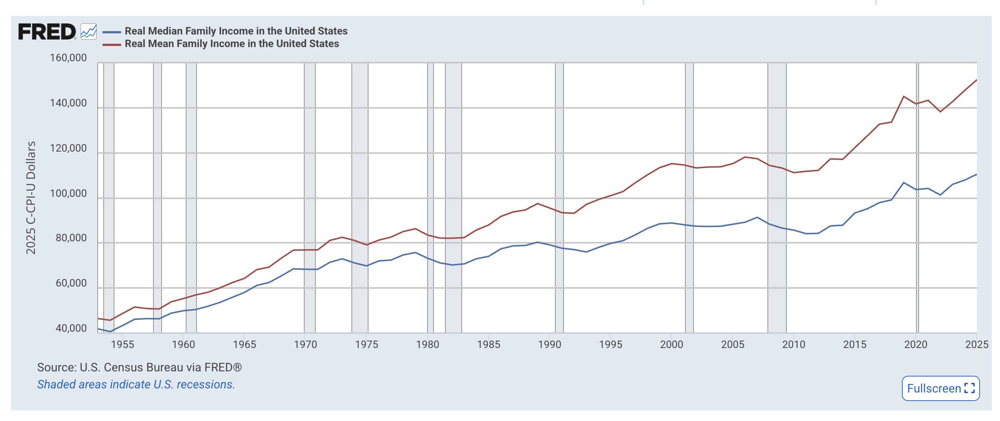

# Preliminaries

## Announcements

- [Exercise-06](../exercises/ex-06-making-maps.qmd) | [ *Canvas dropbox*](https://psu.instructure.com/courses/2484925/assignments/18789309) due Monday, November 16, 2026.

## Today's topic

- Communicating uncertainty and risk
  
# Communicating uncertainty and risk

## Frequencies vs. probabilities

- *p* = .01 vs. 1% chance vs. 1 chance in 100
- *p* = .10 vs. 10% chance vs. 10 chances in 100
- *p* = .40 vs. 40% chance vs. 40 chances in 100

---


## Example closer to home

- What's the probability that Penn State football ends up with a winning (regular) season?
- Current record (2026-11-02) is 4-4; 4 games left.

---

```{r}
#| label: setup
#| echo: true
#| code-fold: false

library(ggplot2)
library(dplyr)
```

```{r}
#| label: generate-data
#| echo: true
#| code-fold: false
#| code-line-numbers: "1-2|3-5"
sim_40 <- rbinom(n = 100, size = 4, prob = .4)
sim_60 <- rbinom(n = 100, size = 4, prob = .6)
psu_proj_df <- data.frame(wins = c(sim_40, sim_60), 
                          p_win = rep(c(40, 60), 
                                      each = 100))
```

---

```{r}
#| label: fig-psu-winning-season
#| echo: true
#| output-location: slide
#| code-fold: false

psu_proj_df |>
  mutate(p_win = factor(p_win)) |>
  mutate(season_outcome = if_else(wins >= 3, "winning_season", "losing_season")) |>
  
  ggplot() +
  aes(x = wins, fill = season_outcome) +
  geom_histogram(bins = 5) +
  facet_grid(cols = vars(p_win)) +
  theme_classic() +
  theme(legend.position = "bottom",
        legend.title = element_blank()) +
  labs(title = "Simulated full 2026 season record outcome for Penn State football.",
       subtitle = "Assume two different probabilities (.4, .6) of winning each of the remaining four games.") +
  theme(text = element_text(size = 14))
```

## Visualizing uncertainty of point estimates

{#fig-wilke-16.3 width="45%"}

## Point estimates

- Types
  - Mean: center of mass
  - Median: middle-most
  - Mode: peak value(s)
- Why use?

---


  
## Point estimates: Considerations

- Is distribution unimodal?
- Is it bell-shaped (e.g., normal), or symmetric?
- Is *n* odd? If not, then calculate median from two middle-most values
- Do the mean or median capture the peak of the data?

::: {.fragment}
- How do I know?
:::

## When it matters...



## When (else) it matters...

```{r}
#| label: fig-bimodal-random-normal-histogram
#| echo: false
#| code-fold: false
#| output-location: slide
#| code-line-numbers: "1-2|3-5|7-10"
p1 <- rnorm(100, 0, 1)
p2 <- rnorm(100, 2, 1)
p_both <- data.frame(value = c(p1, p2), 
                     source = rep(c("p1", "p2"), 
                                  each = 100))
                    
p_both |>
  ggplot() +
  aes(x = value) +
  geom_histogram(bins = 20)
```

---

```{r}
#| label: fig-bimodal-random-normal-violin
#| output-location: slide
p_both |>
  ggplot() +
  aes(x = value) +
  geom_violin()
```

---

```{r}
#| label: fig-bimodal-random-normal-boxplot
#| output-location: slide
p_both |>
  ggplot() +
  aes(x = value) +
  geom_boxplot()
```

---

```{r}
#| label: fig-bimodal-random-normal-density-with-source
#| output-location: slide
p_both |>
  ggplot() +
  aes(x = value, color = source) +
  geom_density()
```

---

```{r}
#| label: fig-bimodal-random-normal-histogram-with-source
#| output-location: slide
p_both |>
  ggplot() +
  aes(x = value, fill = source) +
  geom_histogram(bins = 20)
```

## Comparing two (or more) distributions

```{r}
#| label: viz-sd-vs-sem
#| echo: true
#| code-fold: false
#| code-line-numbers: "1|2|3-13|15-17"
make_data <- function(sample_n, pop_mean = 0, pop_sd = 1) {
  x <- rnorm(sample_n, pop_mean, pop_sd)
  df <- data.frame(sample_n, 
                   pop_mean,
                   pop_sd,
                   value = x)
  df |>
    dplyr::mutate(sample_mean = mean(value),
                  sample_sd = sd(value),
                  sample_sem = sample_sd/sqrt(sample_n))
}
```

---

```{r}
#| label: generate-two-dist-data
#| echo: true
#| code-fold: false
#| code-line-numbers: "1-3|5-7"
in_df <- data.frame(sample_n = rep(100, 100), 
                 pop_mean = rep(0, 100), 
                 pop_sd = rep(1, 100))

samples_df <- purrr::map2(in_df$sample_n, 
                          in_df$pop_mean, make_data) |>
  purrr::list_rbind()
```

---

:::: {.columns}
::: {.column width=50%}
```{r}
#| label: fig-all-values-density
#| fig-cap: "Density plot."
samples_df |>
  ggplot() +
  aes(x = value) |>
  geom_density() +
  xlim(-4.5, 4.5)
```
:::
::: {.column width=50%}
```{r}
#| label: fig-all-values-histogram
#| fig-cap: "Histogram plot."
samples_df |>
  ggplot() +
  aes(x = value) |>
  geom_histogram() +
  xlim(-4.5, 4.5)
```
:::
::::

:::: {.columns}
::: {.column width=50%}
```{r}
#| label: fig-all-values-violin
#| fig-cap: "Violin plot."
samples_df |>
  ggplot() +
  aes(y = value) |>
  geom_violin() +
  coord_flip() +
  xlim(-4.5, 4.5)
```
:::
::: {.column width=50%}
```{r}
#| label: fig-all-values-boxplot
#| fig-cap: "Boxplot."
samples_df |>
  ggplot() +
  aes(x = value, y = "") |>
  geom_boxplot() +
  xlim(-4.5, 4.5)
```
:::
::::

## Boxplot anatomy

:::: {.columns}
::: {.column width=50%}
- Bar, box & whiskers (`geom_boxplot()`)
  - Bar: median
  - Box: middle 50% (25th...75th percentile)
  - Whiskers: middle 90% (5th...95th percentile)
:::
::: {.column width=50%}

:::
::::

## Comparing measures of uncertainty

{#fig-wilke-16.3 width="65%"}


## Confidence intervals


## What are confidence intervals?

- If we did the same study multiple times under similar conditions...
- X% of the time, the sample mean should be in this range
- Calculated from standard error of the mean (SEM)
- Wilke recommends plotting multiple CIs

## Let's make some data

- Same *n*
- Same standard deviation
- Different means: 0 vs. 1

```{r}
#| echo: true
#| code-fold: false
x0 <- rnorm(n = 100, mean = 0, sd = 1) 
x1 <- rnorm(n = 100, mean = 1, sd = 1)
```

## Plot the data

```{r}
#| echo: true
#| label: fig-base-r-scatterplot
#| code-fold: false
#| fig-cap: "A scatterplot using the `plot()` function in base R."
plot(x0, x1, asp = 1)
```

## Histograms

:::: {.columns}
::: {.column width=50%}
```{r}
#| echo: true
#| fig-cap: "Histogram of x0 with mean 0"
#| label: fig-base-r-histogram-x0
#| code-fold: false
hist(x0)
```
:::
::: {.column width=50%}
```{r}
#| echo: true
#| fig-cap: "Histogram of x1 with mean 1"
#| label: fig-base-r-histogram-x1
#| code-fold: false
hist(x1)
```
:::
::::

## Let's 'tidy'-up

- "Tidy" data $\rightarrow$ rectangular data; columns are variables; rows are observations.
- A data frame (`data.frame()`) is a useful way to store tidy data

```{r}
#| echo: true
#| code-fold: false
two_sets <- data.frame(sample_name = c(rep("x0", 100), 
                                       rep("x1", 100)), 
                                       value = c(x0, x1))

dim(two_sets) # What is the dimension (size) of two_sets?
```

```{r}
readr::write_csv(two_sets, "../include/csv/two_sets_1_sd.csv")
```

## Double-checking

:::: {.columns}
::: {.column width=50%}
```{r}
#| echo: true
#| code-fold: false
head(two_sets)
```
:::
::: {.column width=50%}
```{r}
#| echo: true
#| code-fold: false
tail(two_sets)
```
:::
::::

---

::: {.callout-note}
`data.frame()`: makes a rectangular table of data with labeled columns.

`rep()`: replicates or repeats its arguments. So `rep('x0', 100)` makes a vector/array with 100 copies of 'x0'.

We use `value = c(x0, x1)` to combine x0 and x1 into one long set of values.

**Wait!**: You said don't use the equal sign (`=`), but use it here. What gives? Long-story shortened: The equal sign (`=`) only works when we're defining parameters inside a function; the left arrow (`<-`) does not. So, use left arrows for assigning names outside a function and equal signs inside functions.

Syntax is kind of a pain. Remember when you had to learn English grammar?
:::

## Another way to plot

```{r}
#| label: fig-ggplot-side-by-side
#| code-fold: false
#| echo: true
#| output-location: slide
#| code-line-numbers: "|5"
#| fig-cap: "Side by side histograms of the x0 and x1 variables using ggplot's `facet_grid()` function."
two_sets |>
  ggplot() +
  aes(x = value) +
  geom_histogram() +
  facet_grid(cols = vars(sample_name))
```

::: {.fragment}

- `facet_grid()` makes composite figures where the columns (`cols`) or rows (`rows`) specify which variables in the data frame to subset on

:::

## More histogram-like figures

```{r}
#| label: fig-ggplot-density
#| code-fold: false
#| echo: true
#| output-location: slide
#| code-line-numbers: "|4|5"
#| fig-cap: "A density plot of x0 and x1 using the `geom_density()` function."
two_sets |>
  ggplot() +
  aes(x = value, fill = sample_name) +
  geom_density(alpha = .5) +
  theme(legend.position = "none")
```

## Points + error bars

```{r}
#| fig-cap: "Mean + 1 standard deviation"
#| label: fig-ggplot-mean-sd 
#| code-fold: false
#| echo: true
#| output-location: slide
#| code-line-numbers: "|2|3|7-10"
two_sets |>
  dplyr::group_by(sample_name) |>
  dplyr::mutate(mean_val = mean(value), sdev = sd(value)) |>
  dplyr::ungroup() |>
  ggplot() +
  aes(x = sample_name, y = mean_val) +
  geom_point() +
  geom_errorbar(aes(ymin = mean_val - sdev, 
                    ymax = mean_val + sdev, 
                    width = .1)) +
  ylim(-3, 3)
```

---

```{r}
#| fig-cap: "Mean + 1 standard error of the mean" 
#| label: fig-ggplot-mean-sem
#| code-fold: false
#| echo: true
#| output-location: slide
#| code-line-numbers: "2|3-5|7|9-11"
two_sets |>
  dplyr::group_by(sample_name) |>
  dplyr::summarise(mean_val = mean(value), 
                   sdev = sd(value), n = n(), 
                   sem = sdev/sqrt(n)) |>
  ggplot() +
  aes(x = sample_name, y = mean_val) +
  geom_point() +
  geom_errorbar(aes(ymin = mean_val - sem, 
                    ymax = mean_val + sem, 
                    width = .1)) +
  ylim(-3, 3)
```

## SD vs. SEM vs. CIs?

- Standard deviation (SD)
  - *Describes* this sample, but usually derives from population
  - Should stay the same with larger *n*
- Standard error of the mean (SEM)
  - Makes an *inference* based on assumptions about the current sample
  - Shrinks with larger *n*
- Confidence intervals (CIs)

---

{#fig-wilke-16.3 width="65%"}

---


## Alternatives


# Wrap up

## Next time

- Work session

# Resources

## References
