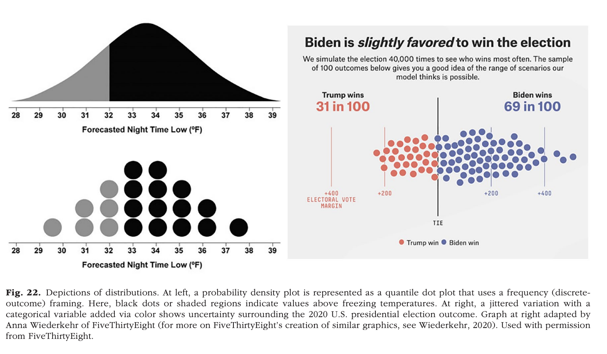
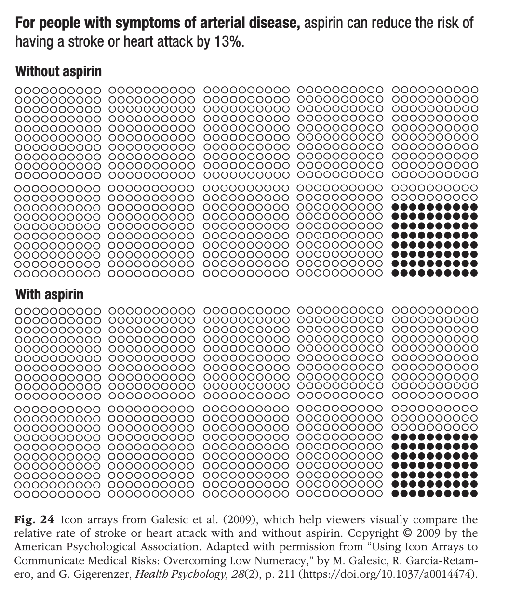
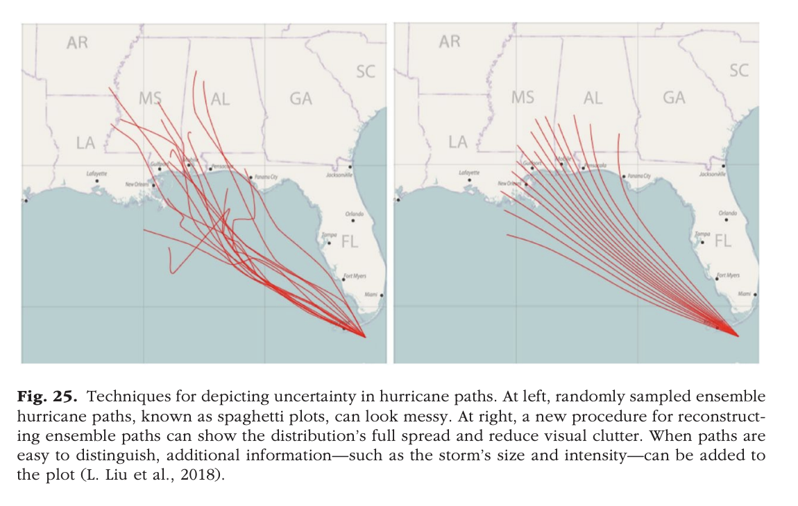
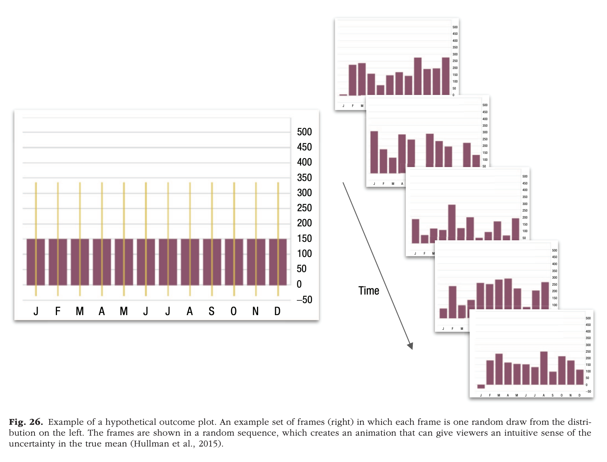
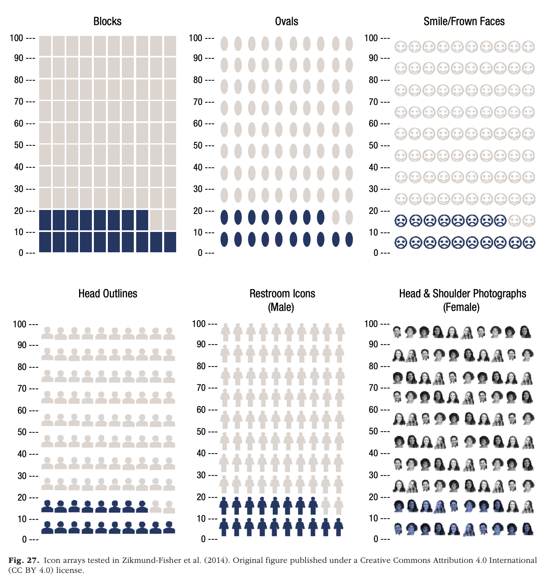
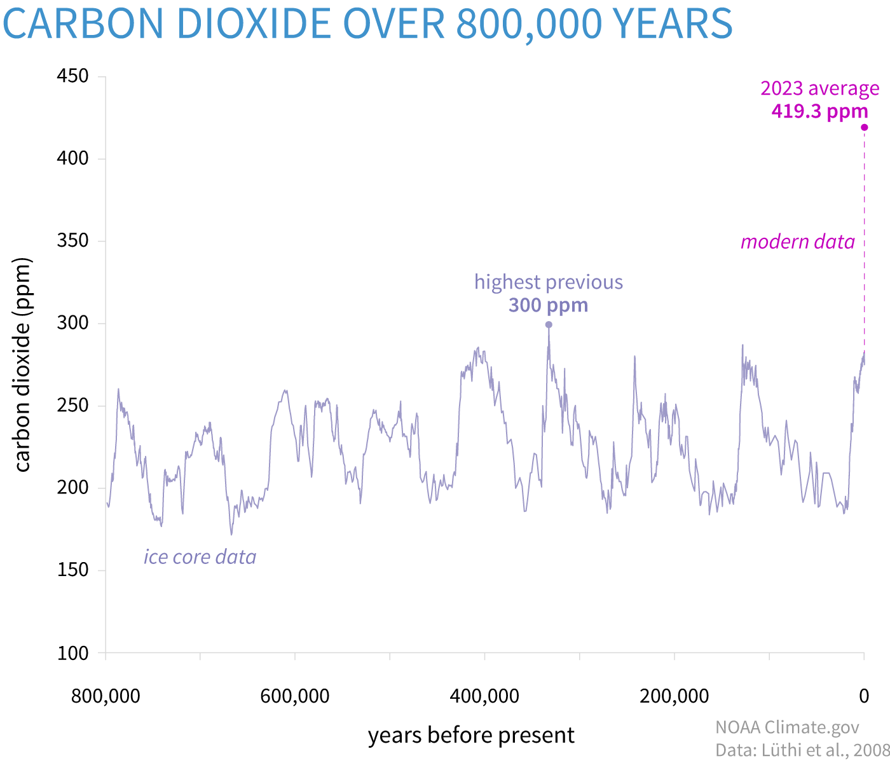

# Preliminaries

## Announcements

- [Exercise-06](../exercises/ex-06-making-maps.qmd) | [ *Canvas dropbox*](https://psu.instructure.com/courses/2484925/assignments/18789309) due Monday, November 16, 2026.

## Today's topic

- Communicating uncertainty and risk
  
# Communicating uncertainty and risk

## Setup

```{r}
library(ggplot2)
library(dplyr)
```

## Let's make some data

- Same *n*
- Same standard deviation
- Different means: 0 vs. 1

```{r}
#| echo: true
#| code-fold: false
x0 <- rnorm(n = 100, mean = 0, sd = 1) 
x1 <- rnorm(n = 100, mean = 1, sd = 1)
```

## Plot the data

```{r}
#| echo: true
#| label: fig-base-r-scatterplot
#| code-fold: false
#| fig-cap: "A scatterplot using the `plot()` function in base R."
plot(x0, x1)
```

## Histograms

:::: {.columns}
::: {.column width=50%}
```{r}
#| echo: true
#| fig-cap: "Histogram of x0 with mean 0"
#| label: fig-base-r-histogram-x0
#| code-fold: false
hist(x0)
```
:::
::: {.column width=50%}
```{r}
#| echo: true
#| fig-cap: "Histogram of x1 with mean 1"
#| label: fig-base-r-histogram-x1
#| code-fold: false
hist(x1)
```
:::
::::

## Let's 'tidy'-up

- "Tidy" data $\rightarrow$ rectangular data; columns are variables; rows are observations.
- A data frame (`data.frame()`) is a useful way to store tidy data

```{r}
#| echo: true
#| code-fold: false
two_sets <- data.frame(sample_name = c(rep("x0", 100), 
                                       rep("x1", 100)), 
                                       value = c(x0, x1))

dim(two_sets) # What is the dimension (size) of two_sets?
```

```{r}
readr::write_csv(two_sets, "../include/csv/two_sets_1_sd.csv")
```

## Double-checking

:::: {.columns}
::: {.column width=50%}
```{r}
#| echo: true
#| code-fold: false
head(two_sets)
```
:::
::: {.column width=50%}
```{r}
#| echo: true
#| code-fold: false
tail(two_sets)
```
:::
::::

---

::: {.callout-note}
`data.frame()`: makes a rectangular table of data with labeled columns.

`rep()`: replicates or repeats its arguments. So `rep('x0', 100)` makes a vector/array with 100 copies of 'x0'.

We use `value = c(x0, x1)` to combine x0 and x1 into one long set of values.

**Wait!**: You said don't use the equal sign (`=`), but use it here. What gives? Long-story shortened: The equal sign (`=`) only works when we're defining parameters inside a function; the left arrow (`<-`) does not. So, use left arrows for assigning names outside a function and equal signs inside functions.

Syntax is kind of a pain. Remember when you had to learn English grammar?
:::

## Another way to plot

```{r}
#| label: fig-ggplot-side-by-side
#| code-fold: false
#| echo: true
#| output-location: slide
#| code-line-numbers: "|5"
#| fig-cap: "Side by side histograms of the x0 and x1 variables using ggplot's `facet_grid()` function."
two_sets |>
  ggplot() +
  aes(x = value) +
  geom_histogram() +
  facet_grid(cols = vars(sample_name))
```

::: {.fragment}

- `facet_grid()` makes composite figures where the columns (`cols`) or rows (`rows`) specify which variables in the data frame to subset on

:::

## More histogram-like figures

```{r}
#| label: fig-ggplot-density
#| code-fold: false
#| echo: true
#| output-location: slide
#| code-line-numbers: "|4|5"
#| fig-cap: "A density plot of x0 and x1 using the `geom_density()` function."
two_sets |>
  ggplot() +
  aes(x = value, fill = sample_name) +
  geom_density(alpha = .5) +
  theme(legend.position = "none")
```

## Points + error bars

```{r}
#| fig-cap: "Mean + 1 standard deviation"
#| label: fig-ggplot-mean-sd 
#| code-fold: false
#| echo: true
#| output-location: slide
#| code-line-numbers: "|2|3|7-10"
two_sets |>
  dplyr::group_by(sample_name) |>
  dplyr::mutate(mean_val = mean(value), sdev = sd(value)) |>
  dplyr::ungroup() |>
  ggplot() +
  aes(x = sample_name, y = mean_val) +
  geom_point() +
  geom_errorbar(aes(ymin = mean_val - sdev, 
                    ymax = mean_val + sdev, 
                    width = .1)) +
  ylim(-3, 3)
```

---

```{r}
#| fig-cap: "Mean + 1 standard error of the mean" 
#| label: fig-ggplot-mean-sem
#| code-fold: false
#| echo: true
#| output-location: slide
#| code-line-numbers: "2|3-5|7|9-11"
two_sets |>
  dplyr::group_by(sample_name) |>
  dplyr::summarise(mean_val = mean(value), 
                   sdev = sd(value), n = n(), 
                   sem = sdev/sqrt(n)) |>
  ggplot() +
  aes(x = sample_name, y = mean_val) +
  geom_point() +
  geom_errorbar(aes(ymin = mean_val - sem, 
                    ymax = mean_val + sem, 
                    width = .1)) +
  ylim(-3, 3)
```

## When to SD vs. SEM?

:::: {.columns}
::: {.column width=50%}
### Standard deviation (SD)
- *Describes* this sample
- Should stay the same with larger *n*
:::
::: {.column width=50%}
### Standard error of the mean (SEM)
- Makes an *inference* based on assumptions about the current sample
- Shrinks with larger *n*
:::
::::

## Let's visualize that!

```{r}
#| label: viz-sd-vs-sem
#| echo: true
#| code-fold: false
#| code-line-numbers: "1-2|4-13|15-17"
in_df <- data.frame(sample_n = c(10, 10, 50, 50, 100, 100),
                    mean = c(0, 1, 0, 1, 0, 1))

make_data <- function(sample_n, sample_mean) {
  x <- rnorm(sample_n, sample_mean)
  df <- data.frame(n = sample_n, 
                   target_mean = sample_mean, 
                   value = x)
  df |>
    dplyr::mutate(mean_val = mean(value),
                  sdev = sd(value),
                  sem = sdev/sqrt(sample_n))
}

samples_df <- purrr::map2(in_df$sample_n, 
                          in_df$mean, make_data) |>
  purrr::list_rbind()
```

---

```{r}
#| label: fig-sd-n-increase
#| echo: true
#| code-fold: false
#| output-location: slide
#| code-line-numbers: "2|3|4|6"
#| fig-cap: "Visualizing the relationship between SD and n using simulated random data."
samples_df |>
  dplyr::select(n, target_mean, sdev, sem) |>
  dplyr::mutate(target_mean = factor(target_mean)) |>
  dplyr::distinct() |>
  ggplot() +
  aes(x = n, y = sdev, color = target_mean) + 
  geom_point() +
  ylim(0, 1.2) +
  labs(title = "Standard deviation as n increases.")
```

---

```{r}
#| label: fig-sem-n-increase
#| echo: true
#| code-fold: false
#| output-location: slide
#| fig-cap: "Visualizing the relationship between SEM and n using simulated random data."
#| code-line-numbers: "|9"
samples_df |>
  dplyr::select(n, target_mean, sdev, sem) |>
  dplyr::mutate(target_mean = factor(target_mean)) |>
  dplyr::distinct() |>
  ggplot() +
  aes(x = n, y = sem, target_mean) + 
  geom_point() +
  ylim(0, 0.4) +
  labs(title = "Standard error of the mean (SEM) as n increases.")
```

## Show me the data!

```{r}
#| label: fig-ggplot-mean-sd-pts
#| code-fold: false
#| echo: true
#| output-location: slide
#| fig-cap: "Using `geom_jitter()` to show all of the data, but with random 'jitter' in the x dimension."
#| code-line-numbers: "|11"
two_sets |>
  dplyr::group_by(sample_name) |>
  dplyr::mutate(mean_val = mean(value), 
                sdev = sd(value)) |>
  dplyr::ungroup() |>
  ggplot() +
  aes(x = sample_name, y = mean_val) +
  geom_errorbar(aes(ymin=mean_val - sdev, 
                    ymax=mean_val + sdev, width = .1)) +
  geom_jitter(aes(y = value), width = .1, height = 0) +
  ylim(-3, 3)
```

## Make the bars easier to see

```{r}
#| fig-cap: "Mean + 1 standard deviation + jittered points"
#| label: fig-ggplot-mean-sd-pts-red
two_sets |>
  dplyr::group_by(sample_name) |>
  dplyr::mutate(mean_val = mean(value), 
                sdev = sd(value)) |>
  dplyr::ungroup() |>
  ggplot() +
  aes(x = sample_name, y = mean_val) +
  geom_errorbar(aes(ymin=mean_val - sdev, 
                    ymax=mean_val + sdev, width = .1),
                color = "red") +
  geom_jitter(aes(y = value), width = .1, height = 0) +
  ylim(-3, 3)
```

---

```{r}
#| fig-cap: "Mean + 1 standard error of the mean + jittered points" 
#| label: fig-ggplot-mean-sem-pts
#| output-location: slide
two_sets |>
  dplyr::group_by(sample_name) |>
  dplyr::mutate(mean_val = mean(value), 
                sdev = sd(value), n = n(), 
                sem = sdev/sqrt(n)) |>
  dplyr::ungroup() |>
  ggplot() +
  aes(x = sample_name, y = mean_val) +
  geom_errorbar(aes(ymin=mean_val - sem, 
                    ymax=mean_val + sem, width = .1)) +
  geom_jitter(aes(y = value), width = .1, height = 0) +
  ylim(-3, 3)
```

---

```{r}
#| fig-cap: "Mean + 1 standard error of the mean + jittered points" 
#| label: fig-ggplot-mean-sem-pts-red
#| output-location: slide
two_sets |>
  dplyr::group_by(sample_name) |>
  dplyr::mutate(mean_val = mean(value), 
                sdev = sd(value), n = n(), 
                sem = sdev/sqrt(n)) |>
  dplyr::ungroup() |>
  ggplot() +
  aes(x = sample_name, y = mean_val) +
  geom_errorbar(aes(ymin=mean_val - sem, 
                    ymax=mean_val + sem, width = .1), 
                color = "red") +
  geom_jitter(aes(y = value), width = .1, height = 0) +
  ylim(-3, 3)
```

---

::: {.callout-warning}
## Adding random noise

Notice that the two plots with jittered data are *not* identical.

Why is that?

The input data are the same, but separate calls to `geom_jitter()` add different amounts of random noise to the points.
:::

## Boxplot + violin + raw

```{r}
#| echo: true
#| label: fig-violin-box-scatter
#| code-fold: false
#| output-location: slide
#| fig-cap: "A combination of a jittered scatterplot with a boxplot and violin plot."
two_sets |>
  ggplot() +
  aes(x = sample_name, y = value) +
  geom_violin() +
  geom_boxplot(alpha = .4) +
  geom_jitter(width = .1, height = 0) +
  theme(text = element_text(size = 14))
```

## Using "beeswarm"

```{r}
#| echo: true
#| label: fig-violin-box-beeswarm
#| code-fold: false
#| output-location: slide
#| fig-cap: "A combination of a 'beeswarm' scatterplot with a boxplot and violin plot."

library(ggbeeswarm)
two_sets |>
  ggplot() +
  aes(x = sample_name, y = value) +
  geom_violin() +
  geom_boxplot(alpha = .4) +
  # geom_jitter(width = .1, height = 0) +
  geom_beeswarm(cex = 1.5) +
  theme(text = element_text(size = 14))
```

## Visualizing relationships between variables

- $y=F(x) + error$
- e.g., shoe_size = F(height)
- Make data that are related to one another
- Can we see the relationship?

---

```{r}
#| echo: true
#| code-fold: false
x <- runif(n = 100, min = 0, max = 1) # Uniform distribution with min 0 and max 1
e <- rnorm(n = 100, mean = 0, sd = 1)
y1 <- x + 0.5*e
y2 <- x + 0.75*e
y3 <- x + e
y4 <- x + 1.5*e
y5 <- e

linear_df <- data.frame(x = x, y1 = y1, y2 = y2, y3 = y3, y4 = y4)
```

---

```{r}
#| label: fig-lin-fit-sd-5
#| fig-cap: "Linear fit with sd=.5"
#| code-fold: false
#| output-location: slide
linear_df |>
  ggplot() +
  aes(x = x, y = y1) +
  geom_point() +
  geom_smooth(method = "lm") +
  ggtitle("Correlation ", cor(x, y1))
```

---

```{r}
#| label: fig-lin-fit-sd-75
#| fig-cap: "Linear fit with sd=.75"
#| code-fold: false
#| output-location: slide
linear_df |>
  ggplot() +
  aes(x = x, y = y2) +
  geom_point() +
  geom_smooth(method = "lm") +
  ggtitle("Correlation ", cor(x, y2)) 
```

---

```{r}
#| label: fig-lin-fit-sd-1
#| fig-cap: "Linear fit with sd=1"
#| code-fold: false
#| output-location: slide
linear_df |>
  ggplot() +
  aes(x = x, y = y3) +
  geom_point() +
  geom_smooth(method = "lm") +
  ggtitle("Correlation ", cor(x, y3))
```

---

```{r}
#| label: fig-lin-fit-sd-1.5
#| fig-cap: "Linear fit with sd=1.5"
#| code-fold: false
#| output-location: slide
linear_df |>
  ggplot() +
  aes(x = x, y = y4) +
  geom_point() +
  geom_smooth(method = "lm") +
  ggtitle("Correlation ", cor(x, y4))
```

---

```{r}
#| label: fig-lin-fit-indep-xy
#| code-fold: false
#| output-location: slide
#| fig-cap: "Linear fit with *independent* unrelated variables"
linear_df |>
  ggplot() +
  aes(x = x, y = y5) +
  geom_point() +
  geom_smooth(method = "lm") +
  ggtitle("Correlation ", cor(x, y5))
```


## Interim summary

- Even when we *know* there are patterns/effects, conveying them accurately and effectively can be challenging

## @Franconeri2021-uv

- Reasoning about statistical properties is *hard*
- Describing relative changes or relative risk is *hard*
- Describing central tendencies of random processes is *hard*
- More vs. less informative ways of conveying same data
- Graphic experience/literacy varies [@Zikmund-Fisher2014-lg]]

---

{#fig-franconeri-fig-22}

## {.scrollable}

{#fig-franconeri-fig-24}

---

{#fig-franconeri-fig-25 width="75%"}

---

{#fig-franconeri-fig-26 width="75%"}

---

{#franconeri-fig-27 width="55%"}

---

>Risk recall was significantly higher with more anthropomorphic icons (restroom icons, head outlines, and photos) than with other icon types, and participants rated restroom icons as most preferred. However, while restroom icons resulted in the highest correlations between perceived and actual risk among more numerate/graphically literate participants, they performed no better than other icon types among less numerate/graphically literate participants.

-- @Zikmund-Fisher2014-lg

## Who understands what?

:::: {.columns}
::: {.column width=50%}

:::
::: {.column width=50%}
{fig-align="center"}
:::
::::

## Or this?

::: {#fig-owid-measles-cases-death-us}

<iframe src="https://ourworldindata.org/grapher/measles-cases-and-death-rate?time=earliest..2024&tab=chart" loading="lazy" style="width: 100%; height: 600px; border: 0px none;" allow="web-share; clipboard-write"></iframe>

@UnknownUnknown-ew
:::

# Wrap up

## Next time

- Work session

# Resources

## References
