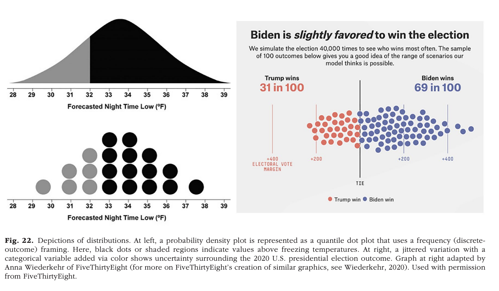
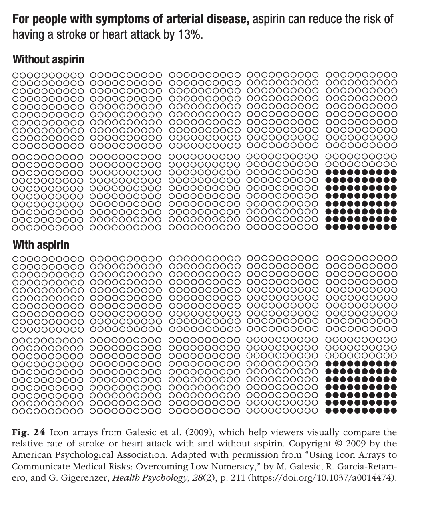
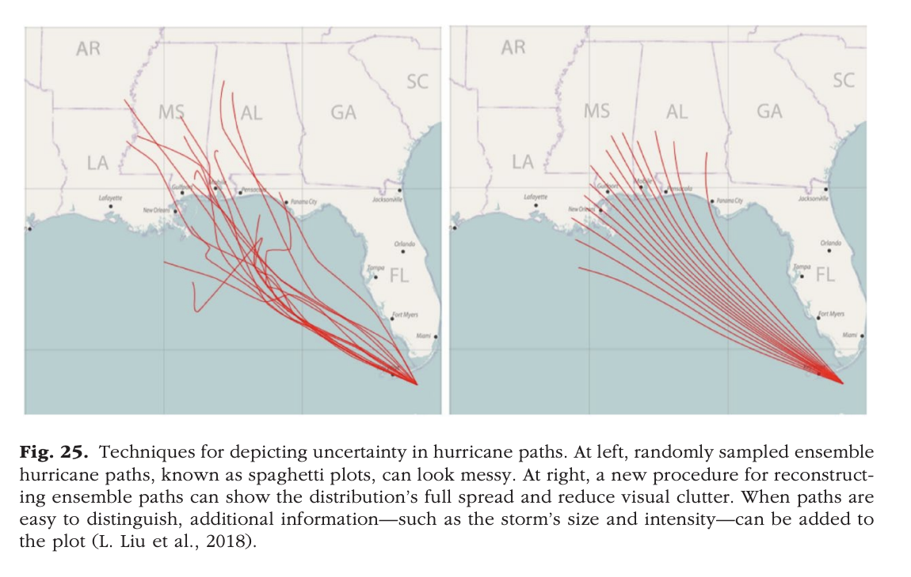
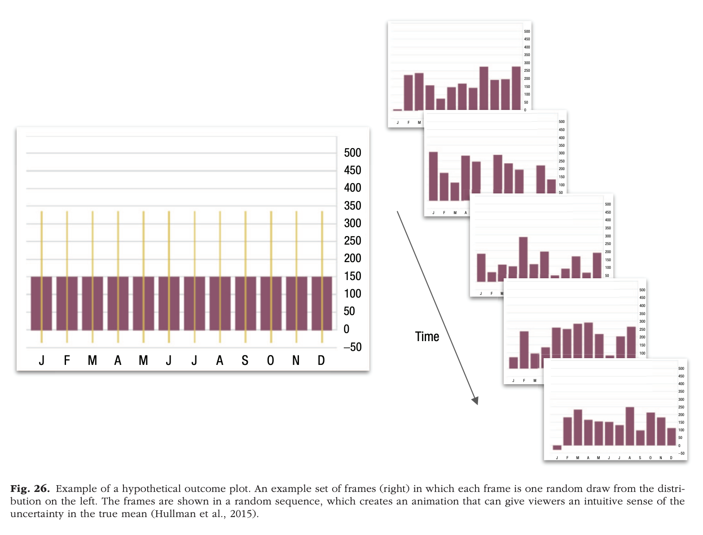
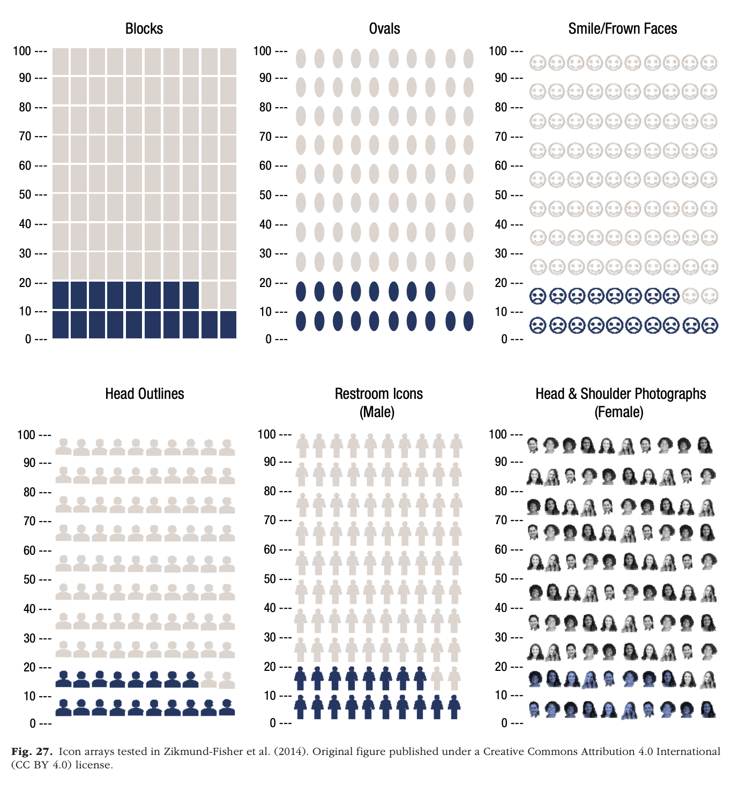
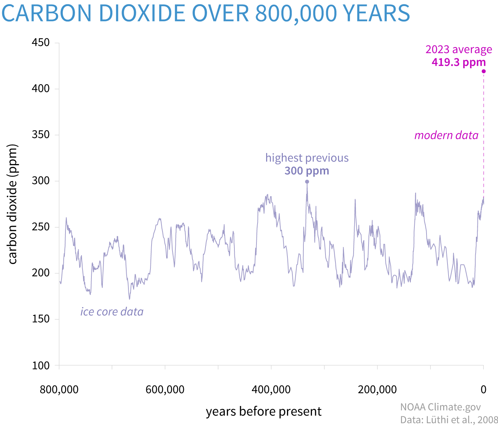

# Preliminaries

## Announcements

- [Exercise-06](../exercises/ex-06-making-maps.qmd) | [ *Canvas dropbox*](https://psu.instructure.com/courses/2484925/assignments/18789309) due Monday, November 16, 2026.

## Today's topic

- Communicating uncertainty and risk
  
# Communicating uncertainty and risk

## Setup

```{r}
library(ggplot2)
library(dplyr)
```

## Comparing measures of uncertainty

{#fig-wilke-16.3 width="65%"}

---

::: {.question}
## Ordinal or continous?

Are the flavor ratings nominal (ordinal) or continuous?

Why do you think so?
:::

{width="65%"}


## Confidence intervals


## What are confidence intervals?

- If we did the same study multiple times under similar conditions...
- X% of the time the *confidence interval* would contain the true value^[of the parameter of interest (here, the mean)] 
- Calculated from standard error of the mean (SEM)
- Wilke recommends plotting multiple CIs with different "levels" of confidence

## Calculating CIs

- CI_low = Sample_mean - Critical_value * SEM
- CI_high = Sample_mean + Critical_value * SEM
- Critical_value: output from `qnorm()` function
  - 80% CI: `{r} qnorm(p = .10)`
  - 95% CI: `{r} qnorm(p = .026)`
  - 99% CI: `{r} qnorm(p = .005)`

## Do CIs really behave that way?

```{r}
#| label: make-ci-data
#| echo: true
#| code-fold: false
random_normal_samples_df <- 
  data.frame(i = rep(1:100, each=100),
             value = rnorm(50*100, 0, 1))

summary_stats_df <- random_normal_samples_df |>
  group_by(i) |>
  summarize(sample_n = n(),
            sample_mean = mean(value),
            sample_sd = sd(value),
            sample_sem = sample_sd/sqrt(sample_n),
                  ci80 = -sample_sem*qnorm(.1),
                  ci95 = -sample_sem*qnorm(.025),
                  ci99 = -sample_sem*qnorm(.005))
```

---

```{r}
#| label: fig-show-sample-dists-histogram
#| fig-cap: "Faceted histogram of 16 of the sample normal distributions."
#| echo: true
#| code-fold: false
#| code-line-numbers: "1-2|4|5-6|7"
#| output-location: slide

random_normal_samples_df |>
  head(n = 16*100) |>
  
  ggplot() +
  aes(x = value) +
  geom_histogram(bins = 20) +
  facet_wrap(vars(i), nrow = 4, ncol = 4)
```

---

```{r}
#| label: fig-show-sample-dists-violin-box
#| fig-cap: "Faceted box and violin plot of 16 of the sample normal distributions."
#| echo: true
#| code-fold: false
#| code-line-numbers: "1-2|4|5-6|7"
#| output-location: slide
random_normal_samples_df |>
  head(n = 16*100) |>
  
  ggplot() +
  geom_violin(aes(x = value, y = "")) +
  geom_boxplot(aes(x = value, y = ""), alpha = .2) +
  facet_wrap(vars(i), nrow = 4, ncol = 4)
```

---

```{r}
#| label: fig-ci-80
#| echo: true
#| code-fold: false
#| code-line-numbers: ""
#| fig-cap: "80% CI"
#| output-location: slide
summary_stats_df |>
  ggplot() +
  aes(x = sample_mean, y = i) +
  geom_point(size = .5) +
  geom_errorbar(aes(xmin = sample_mean - ci80, xmax = sample_mean + ci80)) +
  geom_linerange(aes(x = 0, y = i, ymin = 0, ymax = 50), color = "red") +
  xlim(-2.5, 2.5)
```

---

::: {.question}
## What do we expect?

If we generate *n*=100 intervals at 80% confidence, how many intervals should **fall outside** the true population mean (0)?

:::

::: {.fragment}
::: {.answer}

$p_{outside} = 1-p_{inside} = 1-80\% = 1-.8$, so

$$100*(1-.8)=20$$ 

On average, we expect 20/100 80% CIs will fail to include 0 

:::
:::

---

```{r}
#| label: fig-ci-80-flag-dont-include-mean
#| echo: true
#| code-fold: false
#| code-line-numbers: "2-3"
#| fig-cap: "80% CI with indicator about whether the interval excludes the true mean."
#| output-location: slide
summary_stats_df |>
  mutate(CI_excludes = ((sample_mean - ci80) > 0) |
           ((sample_mean + ci80) < 0)) |>
  
  ggplot() +
  aes(x = sample_mean, y = i) +
  geom_point(size = .5) +
  geom_errorbar(aes(
    xmin = sample_mean - ci80,
    xmax = sample_mean + ci80,
    color = CI_excludes
  )) +
  geom_linerange(aes(
    x = 0,
    y = i,
    ymin = 0,
    ymax = 100
  ), color = "blue") +
  xlim(-2.5, 2.5)
```

---

```{r}
#| label: fig-ci-95
#| echo: false
#| fig-cap: "95% CI with indicator about whether the interval excludes the true mean."
#| output-location: slide
summary_stats_df |>
  mutate(CI_excludes = ((sample_mean - ci95) > 0) |
           ((sample_mean + ci95) < 0)) |>
  ggplot() +
  aes(x = sample_mean, y = i) +
  geom_point(size = .5) +
  geom_errorbar(aes(
    xmin = sample_mean - ci95,
    xmax = sample_mean + ci95,
    color = CI_excludes
  )) +
  geom_linerange(aes(
    x = 0,
    y = i,
    ymin = 0,
    ymax = 100
  ), color = "blue") +
  xlim(-2.5, 2.5)
```

---

```{r}
#| label: fig-ci-99
#| echo: false
#| fig-cap: "99% CI with indicator about whether the interval excludes the true mean."
#| output-location: slide
summary_stats_df |>
  mutate(CI_excludes = ((sample_mean - ci99) > 0) |
           ((sample_mean + ci99) < 0)) |>
  ggplot() +
  aes(x = sample_mean, y = i) +
  geom_point(size = .5) +
  geom_errorbar(aes(
    xmin = sample_mean - ci99,
    xmax = sample_mean + ci99,
    color = CI_excludes
  )) +
  geom_linerange(aes(
    x = 0,
    y = i,
    ymin = 0,
    ymax = 100
  ), color = "blue") +
  xlim(-2.5, 2.5)
```

## CIs and graphical inference

{#fig-wilke-16.3 width="65%"}

---


## Alternatives {.scrollable}

{#fig-wilke-16.9 width="65%"}

## Visualizing relationships *between* variables

- $y=F(x) + \epsilon$, where $\epislon$ is random error
- e.g., shoe_size = F(height)
- Make data that are related to one another
- Can we see the relationship?

---

```{r}
#| echo: true
#| code-fold: false
#| code-line-numbers: "1|2|3-6|7"
x <- runif(n = 100, min = 0, max = 1) # Uniform distribution with min 0 and max 1
e <- rnorm(n = 100, mean = 0, sd = 1)
y1 <- x + 0.5*e
y2 <- x + 0.75*e
y3 <- x + e
y4 <- x + 1.5*e
y5 <- e

linear_df <- data.frame(x = x, y1 = y1, 
                        y2 = y2, y3 = y3,
                        y4 = y4)
```

::: {.fragment}
::: {.question}
## Why generate a *uniform* distribution in x?
:::
:::

::: {.fragment}
::: {.answer}
## Want a roughly equal spread of x values.
:::
::: 

---

```{r}
#| label: fig-lin-fit-sd-5
#| fig-cap: "Linear fit with sd=.5."
#| echo: true
#| code-fold: false
#| output-location: slide
#| code-line-numbers: "5|7"
linear_df |>
  ggplot() +
  aes(x = x, y = y1) +
  geom_point() +
  geom_smooth(method = "lm") +
  ggtitle("Correlation ", cor(x, y1)) +
  ylim(-2, 2)
```

---

```{r}
#| label: fig-lin-fit-sd-75
#| fig-cap: "Linear fit with sd=.75."
#| code-fold: false
#| echo: true
#| output-location: slide
linear_df |>
  ggplot() +
  aes(x = x, y = y2) +
  geom_point() +
  geom_smooth(method = "lm") +
  ggtitle("Correlation ", cor(x, y2))  +
  ylim(-2, 2)
```

---

```{r}
#| label: fig-lin-fit-sd-1
#| fig-cap: "Linear fit with sd=1."
#| code-fold: false
#| echo: true
#| output-location: slide
linear_df |>
  ggplot() +
  aes(x = x, y = y3) +
  geom_point() +
  geom_smooth(method = "lm") +
  ggtitle("Correlation ", cor(x, y3))  +
  ylim(-2, 2)
```

---

```{r}
#| label: fig-lin-fit-sd-1.5
#| fig-cap: "Linear fit with sd=1.5."
#| code-fold: false
#| echo: true
#| output-location: slide
linear_df |>
  ggplot() +
  aes(x = x, y = y4) +
  geom_point() +
  geom_smooth(method = "lm") +
  ggtitle("Correlation ", cor(x, y4)) +
  ylim(-2, 2)
```

---

::: {.question}
## What happens to the correlation as SD increases?
:::

::: {.fragment}
::: {.answer}
## It drops!

Even when we know that x and y are related because we made it that way.
:::
:::

---

::: {.question}
## What happens to slope of the best-fitting line?
:::

::: {.fragment}

::: {.answer}
## It also drops!

Even when we know that x and y are linearly related because we made it that way.
:::

:::

---

```{r}
#| label: fig-lin-fit-indep-xy
#| code-fold: false
#| echo: true
#| output-location: slide
#| fig-cap: "Linear fit with *independent* unrelated variables"
linear_df |>
  ggplot() +
  aes(x = x, y = y5) +
  geom_point() +
  geom_smooth(method = "lm") +
  ggtitle("Correlation ", cor(x, y5))  +
  ylim(-2, 2)
```


## Interim summary

- Even when we *know* there are patterns/effects, conveying them accurately and effectively can be challenging

## @Franconeri2021-uv

- Reasoning about statistical properties is *hard*
- Describing relative changes or relative risk is *hard*
- Describing central tendencies of random processes is *hard*
- More vs. less informative ways of conveying same data
- Graphic experience/literacy varies [@Zikmund-Fisher2014-lg]]

---

{#fig-franconeri-fig-22}

## {.scrollable}

{#fig-franconeri-fig-24}

---

{#fig-franconeri-fig-25 width="75%"}

---

{#fig-franconeri-fig-26 width="75%"}

---

{#franconeri-fig-27 width="55%"}

---

>Risk recall was significantly higher with more anthropomorphic icons (restroom icons, head outlines, and photos) than with other icon types, and participants rated restroom icons as most preferred. However, while restroom icons resulted in the highest correlations between perceived and actual risk among more numerate/graphically literate participants, they performed no better than other icon types among less numerate/graphically literate participants.

-- @Zikmund-Fisher2014-lg

## Who understands what?

:::: {.columns}
::: {.column width=50%}

:::
::: {.column width=50%}
{fig-align="center"}
:::
::::

## Or this?

::: {#fig-owid-measles-cases-death-us}

<iframe src="https://ourworldindata.org/grapher/measles-cases-and-death-rate?time=earliest..2024&tab=chart" loading="lazy" style="width: 100%; height: 600px; border: 0px none;" allow="web-share; clipboard-write"></iframe>

@UnknownUnknown-ew
:::

# Wrap up

## Next time

- Work session

# Resources

## References
