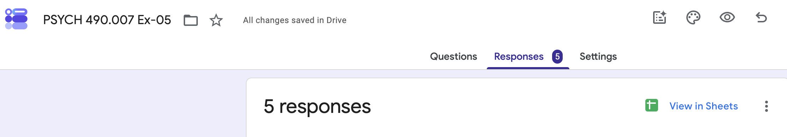
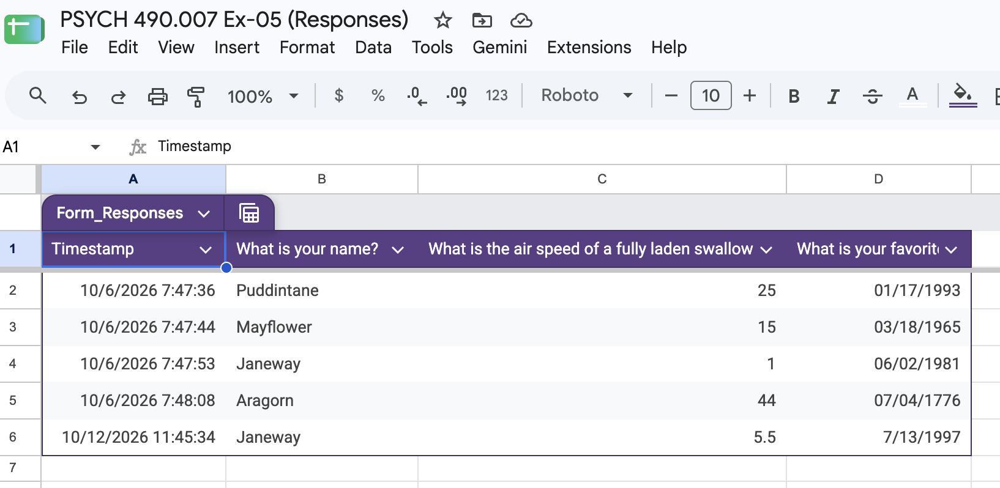
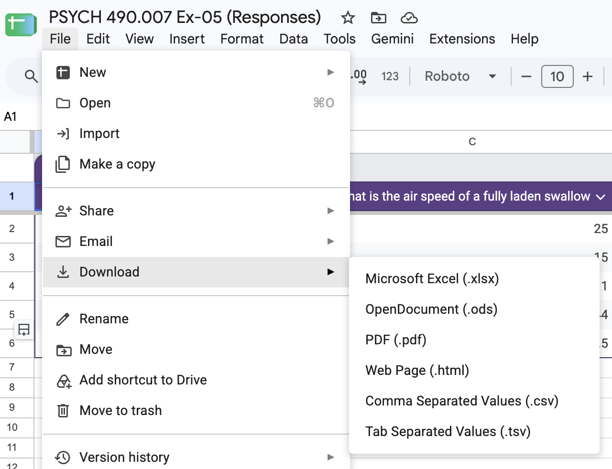

## About {-}

This tutorial shows how we can prepare a dataset generated using Google Forms into a format suitable for plotting.
The format is a data frame in a "tidy" format, where each row is an observation and each column is a variable.

## Setup

```{r}
#| label: setup
library(ggplot2)
library(dplyr)
library(readr)
```

If you are following this tutorial, you will want to do the following:

- Create an RStudio project called `tutorial-tidying-data` or something similar.
- Create a Quarto document inside the project.
  - Modify the `title` in the document header.
  - Add `author`, and `date` fields in the document header.
  - Optionally add parameters so that your HTML document is self-contained.
  - Add `About` and `Setup` sections to your main document and fill them with content, especially the R chunk you will use to load the required packages like *ggplot2*, *readr*, and *dplyr* using `library(ggplot2)` etc.

## Background

Even when a data analyst controls how some dataset is generated, it's essential to transform it into a form that can be easily plotted using *ggplot2*.

The major steps involved are as follows:

- Gathering
  - Importing the data from some canonical source.
- Cleaning
  - (Optional, but highly recommended) Creating a data dictionary.
  - Transforming the data into a tidy format.
  - Renaming data variable (column) names.
- Visualizing
  
We will do this with some survey data that Dr. Gilmore created.
For [Exercise 05](../exercises/ex-05-tidy-data.qmd), you'll do the same process with the data you created in [Exercise 03](../exercises/ex-03-making-data.qmd).

The response form for the survey is here: <https://docs.google.com/forms/d/1-3A8QFqwNABsbOmCAgnrcdjxXULp-aKOW1HqQvPVd3k/edit>.
If you like the shortened form Google provides, it is here: <https://forms.gle/add8aEUUjMowesaQ6>.

## Gathering

There are two ways to gather these data.
One involves downloading a `*.csv` file manually.
If you visit the "Responses" tab for a survey you have permission to access, you'll see a "View in Sheets" button as shown in @fig-view-in-sheets-button.

{#fig-view-in-sheets-button width="75%"}

Click it.

That will open a Google Sheet with the data as shown in @fig-google-sheet.

::: {.callout-important}
## Sample data file

You can download this datafile at the following link:

<https://docs.google.com/spreadsheets/d/1ecLcV1IPGf2UyJKWHH6s81iG0vuiqJJaCELi9di_KHQ/edit?usp=sharing>
:::

{#fig-google-sheet width="75%"}

On 2026-10-12 when I drafted this tutorial, there were 5 responses.

To download a CSV, select "File/Download/Comma Separated Values (.csv)" as shown in @fig-download-csv.

{#fig-download-csv width="75%"}

This will download the file to the default download location on your computer.
The precise file name depends on how many times you've downloaded this file, but on my computer right now, the following code shows the long target file name.

```{r}
#| label: show-downloaded-file-name
list.files(path = "~/Downloads",
           pattern = "PSYCH 490.007",
           full.names = TRUE)
```

::: {.callout-note}
## What are those parameters?

For this exercise, you don't need to automate determining the file name using the `list.files()` function.
However, the `path` parameter tells R where to look for files.
Here, it's in the `Downloads` directory under my root user account which I appreviate using the `~` symbol.
Note: This works on Mac OS and Linux systems, but I'm not sure it works like this in Windows.

The `pattern` parameter tells R to look for the text 'PSYCH 490.007'.
That's how the file name starts.

:::

Now that we've confirmed we have downloaded a `.csv` file, we can drag it to the folder where we're doing our work.
I suggest creating a `data/csv` folder for your data.
Make a directory for the data and copy the file there now.

If you want to use R for this, the following code should work.

```{r}
#| eval: false
dir.create(file.path("data"))
dir.create(file.path("data", "csv"))
```

### Import into R

Now we can import the data into R.
Create a chunk to do that.
Call the data `survey_df`.

```{r}
#| label: import-csv
survey_df <- read_csv(file = "data/csv/PSYCH 490.007 Ex-05 (Responses) - Form Responses 1.csv", show_col_types = FALSE)
```

::: {.callout-warning}
## Your file name may differ!

Note that the code in the chunk above indicates a file name that is specific to my demo, namely `file = "data/csv/PSYCH 490.007 Ex-05 (Responses) - Form Responses 1.csv"`.
Your file name may be different. 
Change it accordingly before running the import code.

:::

::: {.callout-important}
## Type-ahead is your friend

If you pause your typing after you type the first few characters of the path to your file, RStudio will fill in the rest.

In fact, type-ahead helps in all sorts of ways.

Slow down, let the computer do more work, and enjoy the good life!

:::

To confirm that the dataset imported properly, we run `summary(survey_df)`.

```{r}
#| label: summary-survey-df
summary(survey_df)
```

::: {.callout-important}
## `summary()` can be fussy

We have discovered that the `summary()` function doesn't always work well with CSVs downloaded from Google Drive survey sheets.

The `str()` command seems more robust.
So, if `summary()` doesn't work for you, delete that code and move on.
Even better, add `#| eval: false` to the header of the code chunk that doesn't work and add a comment like this: "The code chunk below does not evaluate when we render this Quarto file because the `summary()` function gives an error. I've kept the code in the document for transparency purposes."
:::

An even more useful command to summarize the data is the `str()` for "structure" command.

```{r}
#| label: str-survey-df
str(survey_df)
```

Notice that this command provides us even more information than we had before.

Okay, we're ready to move on to cleaning.

## Cleaning

### Make data dictionary

Until *very* recently, I never made a data dictionary.
I didn't know what one was or why someone should care.
Fortunately, you can teach (some) old dogs new tricks.

It's optional for [Exercise 05](../exercises/ex-05-tidy-data.qmd), but worth extra points, so why not?

First, we extract the full questions using the `names()` command.
This command extracts the column names from a data frame.
We assign it to a variable because we'll want to use it in our data dictionary.

```{r}
#| label: questions
questions <- names(survey_df)
questions
```
Next, we create a new variable with a shortened name.
The question itself is too long.
We want a name that will be informative, but look good in our initial plots.

Here are the choices I made:

```{r}
#| label: short-names
short_names <- c("timestamp",
                "name",
                "swallow_speed",
                "favorite_date")
```

Now, I can make a new data frame with the `questions` and `short_names` variables.

```{r}
survey_dd <- data.frame(questions, short_names)

survey_dd
```

That's not especially interesting, but so far so good.
You could add other columns if you like.
A `comments` column isn't a bad idea.

```{r}
#| label: comments
comments <- c("Provided by Google Forms in MM/DD/YYYY HH:MM:SS format",
              "Fixed responses",
              "A bad reference to 'Monty Python and the Holy Grail'.",
              "Some random dates in MM/DD/YY format.")
```

And you could add a column about the data type.

```{r}
#| label: data-type
data_type <- c("Date/time stamp", 
               "Discrete/Nominal",
               "Continuous",
               "Date")
```

Then add these to the data dictionary data frame.

```{r}
#| label: add-to-data-dictionary-data-frame
survey_dd$data_type <- data_type
survey_dd$comments <- comments
survey_dd
```

Let's quit while we're ahead and export this as a `.csv` in the same directory where our raw data came from, but with a shorter and human-readable name.

```{r}
#| label: save-data-dictionary
write_csv(survey_dd, file = "data/csv/survey_data_dictionary.csv")
```

Okay, back to data cleaning the main dataset.

### Rename columns

As part of generating the data dictionary, we made choices about some better, shorter names for the columns in our dataset.
We can use those names in the raw dataset, as follows.

First, we make a copy of `survey_df`, but with a new name to indicate it's our cleaned version.
This isn't strictly necessary, but it's good practice while you're learning.

```{r}
survey_cleaned_df <- survey_df
```

Then, we give the new dataset, `survey_cleaned_df` the short names from our data dictionary.

```{r}
names(survey_cleaned_df) <- short_names

survey_cleaned_df
```
::: {.callout-important}
## Study this and understand

Make sure you understand what we just did.
It's incredibly useful and powerful.

If you're not sure what's going on, try printing the original and the cleaned data frames, like this:

```{r}
#| eval: false
survey_cleaned_df

survey_df
```

Compare the two outputs.
Isn't the one with shorter names easier to handle?
:::

### Further cleaning

We have two variables we could plot right now, `name`, and `swallow_speed`.
In the section [below](#visualizing) we create simple visualizations of these variables.

### Alternative method

If you don't want to make a data dictionary, there is another way to rename variables in a data frame.
We use a function from the *dplyr* package called `rename()`.

First, make sure that you have installed *dplyr*.
In your R console, run `install.packages("dplyr")`.
Then, load the package by adding `library(dplyr)` to your setup section R chunk.

Now, we're ready to use `rename()`.

In the code below, we "pipe" (`|>`) the original survey data (`survey_df`) to the `rename()` function, then assign (`<-`) the output to a new data frame called `survey_df_renamed`.
Notice that the `rename()` function takes a data frame and returns a new data frame with renamed columns.
The `rename()` function also allows you to specify new column names using a formula-like syntax, such as `new_name = old_name`.
Here, because our old names contain spaces, we surround them with back ticks so that *dplyr* will understand.
We can rename multiple variables using the same command if we separate each `new_name = \`old name\`` by a comma.

::: {.callout-important}
## Expert tip: Use code formatting

RStudio will reformat your code for you to make it more human readable.

Select the section of code you want to reformat, then select the "Reformat section" command from the RStudio "Code" menu.

:::

```{r}
#| label: use-dplyr-rename
#| echo: true
#| code-fold: false
#| 
survey_df_renamed <- survey_df |>
  rename(
    timestamp = `Timestamp`,
    name = `What is your name?`,
    swallow_speed = `What is the air speed of a fully laden swallow (in m/s)?`,
    favorite_date = `What is your favorite date (month, day, year)?`
  )

survey_df_renamed
```

Notice that this gives us the same result as before.

::: {.callout-note}
## What technique to use when?

Should you create a data dictionary and use the `short_name` field to reassign new names to your original data frame, or should you use the `dplyr::rename()` function we just demonstrated? 
As with many (most?) things in life, the answer is: It depends.
I use both.

Creating a data dictionary is a best practice for organizing and documenting your data, especially when working with complex datasets or collaborating with others.
However, you may just want to rename variables and get on with your work.

For work in this class, especially on [Exercise 05](../exercises/ex-05-tidy-data.qmd), you decide.
Maybe try the `rename()` function for this tutorial but snag the extra credit points for Exercise 05 by making a data dictionary.
:::

## Visualizing

We've already used `summary()` and `str()` above, so we won't repeat that here.
Notice that in @fig-barplot-name we use the cleaned dataset.
Also note that we can use `geom_histogram` with discrete, nominal data as long as we use `stat="count"` as a parameter.

```{r}
#| label: fig-barplot-name
#| fig-cap: "A simple barplot of the frequency of responses to the question: 'What is your name?'"

survey_cleaned_df |>
  ggplot() +
  aes(x = name) +
  geom_histogram(stat = "count") +
  theme_classic()
```

::: {.callout-important}
## Make this better

What would make this figure more informative and compelling?

How about sorting the bars, adding some color, adding a better title?
:::

In @fig-swallow-speed-histogram, we plot the `swallow_speed` variable.

```{r}
#| label: fig-swallow-speed-histogram
#| fig-cap: "A histogram of responses to the question: 'What is the air speed of a fully laden swallow (in m/s)?'"

survey_cleaned_df |>
  ggplot() +
  aes(x = swallow_speed) +
  geom_histogram() +
  theme_classic()
```

This specific figure is not very appealing or informative because we have too few data points for a histogram.
But it shows how we can go from raw data to some visualizations in just a few steps.
When you make figures from your own data in Exercise 05, you may discover that some datasets don't work especially well with certain figure types.
This is why I recommend using Quarto and code chunks to make different versions of your figures.
It's a way to build upon previous work *AND* keep track of the history of your exploration.

## Advanced Gathering

::: {.callout-warning}
## Under construction

This section is a work-in-progress.

:::

## Cleaning dates and times

::: {.callout-warning}
## Under construction

This section is a work-in-progress.

:::

